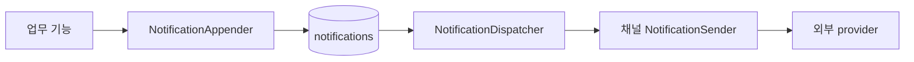

# 알림 추가 가이드

- 기준: 현재 구현
- 목적: 새 알림의 적재 방식과 책임 경계를 빠르게 결정한다.
- 민감한 운영 설정값은 문서나 로그에 기록하지 않는다.

## 핵심 규칙

1. 업무 기능은 수신 대상·발송 시각·템플릿 변수를 결정하고 provider를 직접 호출하지 않는다.
2. 공통 발송 대상은 `notifications`에 저장한다. 한 행은 수신자 한 명·채널 한 개·논리 알림 한 건이다.
3. `deduplication_key`는 같은 논리 알림의 재처리에도 변하지 않게 만든다. 별도 회차로 다시 보낼 때는 회차 식별자를 포함한다.
4. 발송 결과 상태는 `PENDING → SENT | FAILED | UNKNOWN`이다. `SENT`는 provider 접수, `FAILED`는 명시적 거절, `UNKNOWN`은 접수 여부를 판단할 수 없는 결과다. `SENT`는 사용자 도착을 뜻하지 않는다.
5. dispatcher는 `max(scheduled_at, created_at)`이 현재 시각 기준 최근 8분 이내인 due `PENDING`만 조회한다. 지연 적재된 행은 적재 시각부터 창을 적용하고, 그보다 오래된 행은 `PENDING`으로 남겨 자동 발송하지 않는다.
6. provider 호출·요청/응답 변환은 채널 sender가 맡고, dispatcher에는 채널별 분기 로직을 추가하지 않는다.
7. `SENT`·`FAILED`·`UNKNOWN`은 terminal 상태로 자동 재발송하지 않고 30일 후 정리한다. `PENDING`은 자동 정리하지 않는다. 삭제된 행의 중복 키는 다시 사용할 수 있다.



## 알림 유형별 적재 방식

| 상황 | 구현 규칙 | 참고 구현 |
| --- | --- | --- |
| 이벤트 알림, 적재 유실 허용 | 커밋 후 listener에서 전용 실행기로 전달하고 `appendInNewTransaction` 호출 | 가입 알림 |
| 업무 변경과 알림 행을 함께 저장 | 업무 트랜잭션 안에서 `append` 호출. 알림 저장 실패 시 업무도 롤백 | 공통 appender |
| 적재 유실을 허용할 수 없음 | 현재 AFTER_COMMIT 실행기를 쓰지 않는다. transactional outbox 등 내구성 설계를 먼저 추가 | 현재 미구현 |
| 미래 시각·다수 대상 | 업무 소유 API에서 대상과 시각을 계산하고 페이지별 `appendAll` 사용 | 스크랩 리마인드 |

**선택 기준:** 이벤트 처리인지 예약 대상 평가인지 먼저 결정한다. 채널과 템플릿 선택은 별도 결정이다. 예를 들어 FCM 예약 알림은 예약형 적재와 FCM sender가 모두 필요하다.

### 이메일 설정과 템플릿

이메일 sender는 SES SMTP를 `spring.mail.*`로 쓰고, 발신 주소는 광고 문의 확인 메일과 함께 쓰는 공통 키 `ogonggo.mail.from`에서 읽는다. 발신 주소가 비어 있으면 발송하지 않고 `CHANNEL_NOT_CONFIGURED`로 기록한다.

```yaml
spring:
  mail:
    properties:
      mail:
        smtp:
          # 발송 실행기 스레드가 SMTP 응답을 무한정 기다리지 않게 한다. JavaMail 기본값은 무제한이다.
          connectiontimeout: 5000
          timeout: 10000
          writetimeout: 10000

ogonggo:
  mail:
    from: ${OGONGGO_MAIL_FROM:}
```

메일은 provider에 템플릿을 등록하지 않으므로 제목과 본문을 `EmailTemplate`이 소유한다. 알림 행에는 template code와 변수만 저장한다. 본문은 `ogonggo-api-user/src/main/resources/mail/`에 HTML(`*.html`)과 같은 내용의 텍스트(`*.txt`)로 두고 둘 다 보낸다. 문구를 고칠 때는 두 파일을 함께 고친다. 새 메일은 `EmailTemplate`에 항목과 본문 파일을 추가하고 같은 `template_code`로 적재한다. SMTP 예외 메시지에는 수신 주소가 섞일 수 있어 `result_detail`에 원문을 남기지 않는다.

| 결과 | 저장 분류 |
| --- | --- |
| 발신 주소 미설정 | `FAILED` / `CHANNEL_NOT_CONFIGURED` |
| 미등록 template code | `FAILED` / `TEMPLATE_CONFIGURATION` |
| payload 해석 불가, 수신 주소 형식 오류 | `FAILED` / `INVALID_REQUEST` |
| SMTP 인증 실패 | `FAILED` / `AUTHENTICATION_CONFIGURATION` |
| SMTP 서버의 수신자 거절(`SendFailedException`) | `FAILED` / `CLIENT_ERROR` |
| 연결 실패·중단 등 그 밖의 SMTP 오류 | `UNKNOWN` / `TRANSPORT_ERROR` |

### FCM 설정과 payload

FCM sender를 활성화하려면 사용자 API 설정에 Firebase 서비스 계정 정보를 넣는다. 모든 값을 생략하면 Google Application Default Credentials를 사용한다. 일부 값만 설정하면 기동 시 실패한다.

```yaml
ogonggo:
  firebase:
    enabled: true
    project-id: ${OGONGGO_FIREBASE_PROJECT_ID:}
    client-id: ${OGONGGO_FIREBASE_CLIENT_ID:}
    client-email: ${OGONGGO_FIREBASE_CLIENT_EMAIL:}
    private-key-id: ${OGONGGO_FIREBASE_PRIVATE_KEY_ID:}
    private-key: ${OGONGGO_FIREBASE_PRIVATE_KEY:}
```

서비스 계정 값은 저장소에 커밋하지 않는다. 로컬은 gitignored `application-dev.yml`, 운영은 배포 환경의 Secret YAML에 넣는다. `private-key`는 실제 줄바꿈 또는 escaped `\\n`을 사용할 수 있다.

FCM 알림의 `payload_json`은 다음 형태다. `data`는 Firebase 메시지 데이터 규칙에 맞춰 문자열 값만 사용한다.

```json
{
  "title": "마감 임박",
  "body": "스크랩한 공고가 내일 마감됩니다.",
  "data": {"jobId": "7"}
}
```

수동 발송 경로를 확인할 때는 로그인한 사용자의 FCM 토큰을 먼저 저장한 뒤 다음 API를 호출한다.

```http
POST /api/v1/users/me/notifications/fcm/test
Content-Type: application/json
Authorization: Bearer {ogonggo-access-token}
```

```json
{
  "title": "오공고 FCM 테스트",
  "body": "FCM 알림 발송 테스트입니다.",
  "data": {"source": "manual-test"}
}
```

- API는 임의 토큰을 받지 않고 저장된 본인 토큰으로 `FCM/PENDING` notification만 적재한다.
- 응답의 `deduplicationKey`는 적재된 행을 DB에서 찾을 때 사용한다. 실제 provider 요청과 결과는 기존 dispatcher가 비동기로 처리한다.
- Firebase 설정이 비활성화된 환경에서는 dispatcher가 `CHANNEL_NOT_CONFIGURED`로 결과를 기록하므로, provider 호출 테스트 전 설정 활성화를 확인한다.
- 잘못된 토큰 테스트는 이 API의 응답 `200`이 아니라 이후 `notifications.status`, `result_code`, CloudWatch 로그에서 확인한다.

### 다중 기기 FCM 토큰

회원별 토큰은 core의 `UserFcmToken`과 `user_fcm_tokens`에 저장한다. `users.fcm_token`은 이관 원본으로만 남기고 런타임에는 읽거나 쓰지 않는다.

| API | 요청·응답 |
| --- | --- |
| `PUT /api/v1/users/me/fcm-token` | `{ "token": "...", "deviceId": "a03a7396-907a-4e7f-a127-0cf5a80565ca" }`. 해당 설치만 등록·갱신하고 기존 `{ token }` 응답 유지 |
| `GET /api/v1/users/me/fcm-token` | 가장 최근 등록·갱신된 활성 토큰 한 개를 `{ token }`으로 반환. 없으면 null |
| `DELETE /api/v1/users/me/fcm-token` | 본문 `{ "token": "..." }`. 본인 소유의 일치하는 활성 토큰만 해제. 이미 해제됐거나 남의 토큰이어도 200, `data: null` |

- 토큰은 공백만 있는 값을 제외한 최대 4,096자다. `deviceId`는 설치별로 생성·유지하는 UUID 문자열이며 대소문자는 같은 설치로 정규화한다.
- 기존 PUT의 `token` 단독 요청과 `deviceId: null`은 회원별 기존 클라이언트 슬롯만 교체한다. 다른 UUID 설치의 서로 다른 토큰은 유지한다.
- 클라이언트는 로그아웃 전에 해당 설치의 토큰으로 DELETE를 호출한다. 다른 설치의 토큰은 보내지 않으며, 설치 UUID는 다음 로그인에도 유지한다.
- 실제 설치의 활성 슬롯은 계정과 무관한 UUID, 기존 클라이언트는 `legacy:{userId}`다. `active_slot`은 이 슬롯의 DB 유니크 제약을 위한 파생 키다. 같은 설치의 토큰 갱신은 행 ID를 유지한다.
- 같은 설치나 토큰을 다른 계정에 등록하면 이전 연결을 소프트 삭제한다. 같은 토큰을 다른 슬롯에 다시 등록해도 활성 연결은 하나만 유지한다. 해제 시 토큰 원문·해시·활성 슬롯을 null로 비우고 `device_id`, 회원 ID, 해제 시각을 남긴다.
- 회원 행과 기존 연결을 잠가 등록을 처리한다. 활성 해시·슬롯 유니크 제약이 아직 행이 없는 동시 등록도 방어하며, 충돌·교착은 409 `FCM_TOKEN_CONFLICT`다. 클라이언트는 요청 전체를 재시도한다. 자동 재시도는 하지 않는다.
- 세 API와 수동 테스트 발송은 활성 회원만 허용한다. 미인증은 401, 정지·탈퇴는 403, 없는 회원은 404다.
- `UserFcmTokenReader.readActive`는 다음 알림 적재에 사용할 토큰 행 ID와 원문을 반환한다. 토큰을 로그로 출력하지 않는다. 기존 수동 테스트 API는 가장 최근 활성 토큰 한 개만 사용한다.
- sender는 provider 호출 직전에 회원의 활성 상태와 해당 토큰의 현재 소유권을 확인한다. 해제·갱신·계정 전환으로 대상이 달라졌으면 `FAILED / CLIENT_ERROR / FCM_RECIPIENT_INACTIVE`로 끝낸다. 확인과 외부 호출 사이까지 잠그지는 않으므로 이미 시작한 provider 요청을 취소하는 보장은 없다.
- `UNREGISTERED`만 발송한 회원 ID와 토큰 해시가 여전히 일치할 때 조건부 해제한다. 이전 토큰 응답이 새 토큰이나 다른 소유자의 연결을 지우지 않는다. 다른 Firebase 오류는 토큰을 해제하지 않는다.

### 다중 기기 토큰 이관·배포

1. 운영 스키마와 백업을 확인한다. 기존 초기 SQL의 `users.fcm_token`·`notifications`가 필요하다.
2. 토큰 PUT·DELETE 요청을 유지보수 응답으로 막고 진행 중 요청을 마친다. DB의 기존 `notificationDelivery` 작업을 비활성화하고 진행 중 발송을 마친다. 기존 enabled 값을 기록해 재개할 때 복원한다.
3. [`2026-10-21-user-fcm-tokens.sql`](../schema/2026-10-21-user-fcm-tokens.sql)을 한 번 적용한다. 새 테이블 생성·수신 주소 4,096자 확장·기존 토큰 이관을 수행한다. 여러 회원에게 같은 토큰이 있으면 모두 제외하며 원문은 출력하지 않는다. DDL은 MySQL에서 자동 커밋되므로 트랜잭션으로 되돌릴 수 없다.
4. 새 사용자 API를 배포하고 이전 인스턴스를 모두 내린다. 관리자 API도 새 core를 포함해 통상 배포하되, 토큰 API·발송기의 소유권은 사용자 API에 있다.
5. 이관 건수·중복 제외 건수와 새 API 동작을 확인하고 토큰 등록·해제와 기존 발송 작업을 재개한다. 대기열의 이전 토큰도 발송 전 확인을 받는다. 유지보수 중 8분 창을 지난 대기 알림은 자동 재발송하지 않는다.

새 토큰 쓰기를 재개하기 전에는 이전 버전으로 되돌리고 새 테이블·확장 컬럼을 그대로 둘 수 있다. 재개 후에는 `users.fcm_token`이 새 등록·해제를 반영하지 않으므로 곧바로 이전 버전으로 되돌리면 해제한 토큰을 다시 쓰거나 다른 계정에 발송할 수 있다. 다시 요청·발송을 중단하고 현재 소유권 기준의 별도 역이관을 검토하거나 수정 버전을 배포한다. 새 테이블을 삭제하거나 과거 원본을 무조건 덮어쓰는 롤백은 하지 않는다.

## 구현 규칙

### 적재와 중복 방지

- API 모듈은 `NotificationAppender`를 사용하고 Repository/JPA Entity를 직접 조작하지 않는다.
- `append`·`appendAll`은 호출자의 트랜잭션에 참여한다. 한 번의 적재를 원자적으로 저장할 때 사용한다.
- `appendInNewTransaction`은 호출자와 분리된 저장이 필요한 경우에만 사용한다. 가입 알림은 커밋 후 전용 실행기에서 호출하므로 프로세스 종료 시 적재가 유실될 수 있다.
- `deduplication_key`의 DB unique 제약을 최종 중복 방지 수단으로 유지한다. 선행 조회 뒤 동시 insert가 경합하면 해당 배치 트랜잭션이 롤백될 수 있으며, 현재 별도 무시·복구 처리는 하지 않는다. `INSERT IGNORE`는 중복 키 외 오류까지 경고로 낮출 수 있으므로 기본 대안으로 쓰지 않는다.
- 주소와 payload 원문은 로그에 남기지 않는다.

### 예약형 알림

- 대상 자격, 예정 시각, 늦은 실행, 취소·변경 정책은 해당 업무 기능이 소유한다.
- 재시작 시 `notifications` 행이 진행 기록으로 충분하면 별도 일정/커서 테이블을 만들지 않는다. 공고 리마인드의 D-1은 `jobs.recruitment_end_at - 24시간`으로 조회 시 계산하고, 안정적인 알림 키에 이 시각을 포함한다. D-1이 지났더라도 실제 마감 전이면 기존 적격 스크랩을 처리하며, D-1 이후 새로 활성화한 스크랩은 `active_since`로 제외한다.
- scheduler는 소유 API의 `ScheduledJobDefinition`과 `@SchedulerLock`을 사용한다. 실행 주기와 활성화는 `scheduled_jobs`에서 관리한다.
- 페이지 커서는 한 scheduler 실행 안에서만 유지한다. 재실행은 처음부터 조회하되, 이미 적재된 알림은 중복 키와 `notifications` 조회로 건너뛴다. provider 호출은 적재 트랜잭션 밖에서 한다.

### 템플릿과 채널

- 같은 채널의 새 템플릿은 새 알림 적재 로직만 추가하고 기존 sender를 재사용한다. 승인된 `templateCode`와 payload 키를 일치시킨다.
- NHN 템플릿 본문은 provider에 둔다. 애플리케이션은 template code와 변수만 전달한다.
- 새 채널은 `NotificationChannel`과 해당 채널의 `NotificationSender`·provider adapter·설정·오류 변환을 추가한다. dispatcher 수정은 필요하지 않도록 유지한다.
- sender 미등록 채널은 `CHANNEL_NOT_CONFIGURED`로 실패한다. enum 값만 추가해도 발송되지는 않는다.
- provider 결과는 원본 `result_code`, 공통 의미 `result_category`, 민감정보를 제거한 `result_detail`을 함께 저장한다. 의미가 확인된 명시적 거절은 `FAILED`, 접수 여부가 불명확한 응답은 `UNKNOWN`으로 기록하며 둘 다 자동 재발송하지 않는다. provider 응답 원문은 저장하지 않고, 채널 sender가 정규화한 안전한 상세만 최대 500자로 보존한다.
- NHN의 현재 코드표는 API 요청 응답 코드만 분류한다. `SENT`는 NHN 접수이며, NHN→카카오 실제 전달 결과 코드는 조회하지 않는다.
- 채널의 멱등성·재시도 정책은 해당 provider 특성으로 검토한다. 현재 공통 자동 재시도는 없다.

| 코드/응답 | 저장 분류 | 해석 |
| --- | --- | --- |
| NHN `-1005` | `UNKNOWN` / `DUPLICATE_REQUEST` | 같은 멱등성 키 응답만으로는 최초 요청의 접수 여부를 확인할 수 없음 |
| NHN `-1000`, `-1001` | `FAILED` / `AUTHENTICATION_CONFIGURATION` | 앱키·비밀 키 설정 오류로 명시적 거절 |
| NHN `-3003` ~ `-3005` | `FAILED` / `TEMPLATE_CONFIGURATION` | 템플릿 없음·파라미터·승인 상태 오류로 명시적 거절 |
| HTTP `429` / 일반 `4xx` | `FAILED` / `RATE_LIMITED`·`HTTP_ERROR` | provider의 명시적 요청 거절 |
| HTTP `5xx`, 통신·client 예외, 해석 불가 응답 | `UNKNOWN` / 해당 `result_category` | provider 접수 여부를 확인할 수 없음 |
| 미등록 NHN 코드 | `UNKNOWN` / `UNKNOWN_PROVIDER_ERROR` | 원본 코드는 보존하지만 의미를 확인할 수 없어 재발송하지 않음 |

## 운영상 한계

- `/actuator/metrics`는 `127.0.0.1` 요청만 허용한다. 적재·발송 카운터는 인스턴스별 누적값이고, 대기량 gauge는 공용 DB를 조회한다.
- 카운터는 재시작 시 초기화되며, 시간대별 대시보드와 자동 경보는 구성되어 있지 않다.
- 발송 창을 지난 `PENDING`은 자동 발송·정리하지 않는다. `UNKNOWN`도 자동 재발송하지 않으므로 결과 확인과 후속 판단은 운영에서 수행한다.

## 패키지 컨벤션

- 도메인 대상 조회·projection: 대상 도메인의 core 패키지 (채용공고 리마인드는 `ogonggo-core/job`)
- 알림 대상 정책·예정 시각·payload 구성: 소유 API의 `notification/intake`
- 공통 모델·적재 계약·발송 결과·저장소: `ogonggo-core/notification` (intake, delivery, persistence)
- polling·dispatcher·sender 계약·정리 scheduler: 소유 API의 `notification/delivery`
- 채널별 provider client·요청/응답 DTO·인증 설정·sender 구현: 소유 API의 `notification/channel/<channel>`
- Actuator 지표: 소유 API의 `notification/metrics`
- scheduler 정의는 소유 API의 `config`, 실행 주기와 활성 상태는 `scheduled_jobs`

## 새 알림 체크리스트

- [ ] 유실 허용 여부와 적재 방식(커밋 후 / 업무 트랜잭션 / 예약형)을 정했는가?
- [ ] 수신 대상·예정 시각·취소/변경 규칙을 업무 기능에 두었는가?
- [ ] 안정적인 `deduplication_key`, 채널, template code, payload, 수신 주소를 준비했는가?
- [ ] 대상 선정·payload·중복 실행·트랜잭션 경계 테스트를 작성했는가?
- [ ] provider 성공/실패와 미등록 채널 처리를 테스트했는가?
- [ ] scheduler나 스키마가 필요하면 작업 행·enabled 상태·SQL 배포 순서를 확인했는가?

테스트는 한국어 `@DisplayName`, 백틱 함수명, `// given / when / then`을 사용한다. 세부 규칙은 [테스트 작성 가이드](testing.md)를 따른다.

## 현재 구현상 유의점

- 실제 발송 sender는 `KAKAO`, `EMAIL`과 설정이 활성화된 `FCM`이다. FCM 토큰은 설치별 `user_fcm_tokens`에서 조회하고, 알림 행의 `recipient_address`에 대상 토큰을 넣어 발송한다.
- 일반 회원 가입(오공고 계정 최초 생성) 이벤트는 가입 알림톡과 가입 환영 메일을 listener별로 따로 적재한다. 한 채널의 생략·적재 실패는 다른 채널에 영향을 주지 않는다. 기업 회원 가입은 이 이벤트를 발행하지 않는다.
- 스크랩 리마인드 scheduler는 템플릿 승인 전까지 코드 등록이 보류되어 있어 현재 실행되지 않는다.
- 템플릿 코드는 알림 행의 `template_code`를 사용한다. `nhn.templateCode`는 호환용 설정이다.
- NHN 멱등성은 provider의 단기 중복 억제일 뿐 애플리케이션 재시도 정책이 아니다. provider 접수 이후 사용자 도착 여부도 현재 추적하지 않는다.
- `max(scheduled_at, created_at)` 기준 최근 8분 이내의 due `PENDING`만 dispatcher가 읽는다. NHN 멱등성 10분보다 2분 짧게 잘라 결과 저장 실패 후 재호출 가능 구간을 제한한다. 늦게 적재된 D-1 알림은 적재 시각부터 처리 창을 적용한다. 두 시각 모두 8분을 넘긴 행은 상태를 바꾸거나 삭제하지 않고 남겨 운영 조회 대상으로 둔다.
- dispatcher 전체 ShedLock은 최대 90초다. 실행이 끝날 때 60초 이상 걸렸으면 경고 로그를 남기며, 반복되면 lock 시간을 늘릴 운영 신호로 본다. 행별 claim은 없으므로 만료된 lock과 장시간 정지 상황까지 수학적으로 중복 발송을 막는 보장은 아니다.

## 기준 코드

- 적재 계약: [NotificationAppender](../../ogonggo-core/src/main/kotlin/com/ogonggo/core/notification/intake/implement/NotificationAppender.kt), [NotificationAppendDto](../../ogonggo-core/src/main/kotlin/com/ogonggo/core/notification/intake/implement/dto/NotificationAppendDto.kt)
- 가입 이벤트: [UserSignUpAlimTalkEventListener](../../ogonggo-api-user/src/main/kotlin/com/ogonggo/userapi/notification/intake/implement/signup/UserSignUpAlimTalkEventListener.kt), [UserSignUpEmailEventListener](../../ogonggo-api-user/src/main/kotlin/com/ogonggo/userapi/notification/intake/implement/signup/UserSignUpEmailEventListener.kt)
- 예약형 적재: [JobBookmarkReminderEnqueueService](../../ogonggo-api-user/src/main/kotlin/com/ogonggo/userapi/notification/intake/business/JobBookmarkReminderEnqueueService.kt), [JobBookmarkReminderScheduler](../../ogonggo-api-user/src/main/kotlin/com/ogonggo/userapi/notification/intake/implement/reminder/JobBookmarkReminderScheduler.kt)
- 발송 확장: [NotificationDispatcher](../../ogonggo-api-user/src/main/kotlin/com/ogonggo/userapi/notification/delivery/implement/NotificationDispatcher.kt), [NotificationSender](../../ogonggo-api-user/src/main/kotlin/com/ogonggo/userapi/notification/delivery/implement/NotificationSender.kt), [KakaoNotificationSender](../../ogonggo-api-user/src/main/kotlin/com/ogonggo/userapi/notification/channel/alimtalk/KakaoNotificationSender.kt), [EmailNotificationSender](../../ogonggo-api-user/src/main/kotlin/com/ogonggo/userapi/notification/channel/email/EmailNotificationSender.kt)
- FCM 토큰·sender: [FcmTokenController](../../ogonggo-api-user/src/main/kotlin/com/ogonggo/userapi/notification/fcm/presentation/FcmTokenController.kt), [FcmNotificationSender](../../ogonggo-api-user/src/main/kotlin/com/ogonggo/userapi/notification/fcm/implement/FcmNotificationSender.kt)
- 운영 주기: [스케줄 작업 가이드](scheduling.md), [시간 처리 가이드](time-handling.md)
