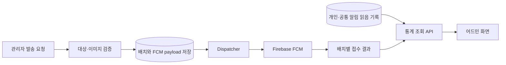

# 푸시 이미지·어드민 통계 작업계획서

- 작성일: 2026-11-03
- 기준 브랜치: `feat/notification-member-topics` (`1bf566b`)
- 상태: 권장안으로 구현 완료. 검증 결과는 구현 보고를 참조

## 바로 다음 작업

관리자 푸시 발송에 이미지 첨부를 지원하고, 발송 결과와 알림함 읽음 현황을 어드민에서 집계할 API를 추가한다. 이미지 전달과 통계 API를 두 수직 슬라이스로 나눈다.

## 현재 구현과 남은 범위

- `GET /api/v1/admin/notification-batches/{batchId}`는 배치별 `sentCount`, `failedCount`, `unknownCount`, `pendingCount`, `expiredCount`를 제공한다. 기간·대상별 통계 API는 없다.
- 사용자 알림함의 읽음 시각은 `user_notifications.read_at` 또는 `notification_broadcast_reads`에 저장된다. 어드민 배치별 읽음 수·읽음률 조회는 없다.
- 현재 FCM payload는 제목·본문·data만 처리한다. 이미지 입력과 Firebase 메시지의 이미지 필드는 연결돼 있지 않다.
- `SENT`는 Firebase 접수 결과다. 단말 도착이나 푸시를 눌러 앱을 연 횟수는 수집하지 않는다.

## 왜 하는가

관리자는 배치별 발송 결과를 볼 수 있지만 기간별 성과나 알림함 읽음 현황을 비교할 수 없다. 푸시 이미지도 요청부터 FCM 전송까지 연결돼 있지 않다. 이미지 발송과 측정 가능한 어드민 보고 API를 제공한다.

## 기대 결과

- 이미지가 있는 직접 발송과 토픽 발송 모두 FCM에 이미지 정보를 전달한다. 이미지 없는 요청은 기존 계약을 유지한다.
- 배치 통계는 성공·실패·미확정·대기 수와 대상 유형을 구분한다. 성공은 `FCM 접수`로 표시한다.
- 읽음 통계는 읽은 회원 수와 비율을 제공한다. 기기 수가 아닌 회원 수를 센다.
- 기간·대상 유형별 집계 API를 추가한다. 경로는 예시로 `GET /api/v1/admin/notification-batches/statistics`를 제안하며 API 계약 단계에서 확정한다.
- 초기 조회 범위는 발송 결과 보관 정책에 맞춰 생성 후 30일 이내로 제한한다. 더 긴 기간이 필요하면 집계 보존 방식을 별도 설계한다.
- API 계약을 관리자 프론트엔드에 전달한다. 화면 구현은 프론트엔드 저장소의 별도 작업이다.

## 구현 순서

1. **계약 확정**: 이미지 입력 방식, 조회 통계의 의미, 집계 단위, 보관 기간을 정한다. 직접 발송은 토큰 접수 수, 토픽 발송은 토픽 요청 수로 구분한다.
2. **이미지 전달**: 이미지 자산 참조 또는 HTTPS URL 입력을 선택한다. 요청·배치에 이미지 참조를 저장하고 FCM payload와 sender에 연결한다. 잘못된 참조는 저장 전에 거부하며 생략 요청은 하위 호환한다.
3. **어드민 통계**: 기존 배치별 발송 상태를 재사용한다. 직접 읽음은 `user_notifications`, 토픽 읽음은 `notification_broadcast_reads`에서 집계한다. 다중 기기 회원은 한 번만 센다. 관리자 전용 기간·대상별 집계 API를 추가한다.
4. **보관·쿼리 검토**: 조회 범위와 30일 보관 경계를 적용한다. 쿼리 비용을 확인해 필요한 인덱스만 추가한다.
5. **계약·운영 문서**: OpenAPI에 이미지 입력·오류와 통계 단위·필터를 명시하고, 관리자 프론트엔드에 응답 계약을 전달한다.

## 테스트 계획

- 이미지 생략은 허용하고 기존 payload 동작을 유지한다.
- 잘못된 형식·없는 이미지·사용 불가 자산은 발송 기록 없이 거부한다.
- 직접 발송과 토픽 발송 모두 FCM 메시지에 이미지 필드를 포함한다.
- 직접 발송에서 여러 기기를 가진 한 회원은 읽음 회원 수에 한 번만 포함한다.
- 토픽 공지는 회원별 읽음 기록으로 집계하고 역할별 노출 조건을 반영한다.
- 관리자 인증, 기간 경계, 빈 결과, 대상 유형별 합계와 30일 조회 경계를 검증한다.
- Firebase·렛츠커리어 호출은 테스트 대역으로 격리한다. DB 집계 의미가 중요한 부분만 영속성 또는 통합 테스트로 검증한다.

## 이번 작업에서 하지 않을 것

- FCM 접수를 실제 단말 도착으로 해석하지 않는다.
- 모바일 이벤트 수집 없이는 푸시 탭/앱 열기 통계를 제공하지 않는다.
- 이미지 편집·여러 이미지·동영상·자동 변환은 포함하지 않는다.
- 관리자 프론트엔드 화면 구현은 이 백엔드 계획 범위 밖이다.
- 장기 통계를 위해 발송 결과 보관 기간이나 개인정보 보관 정책을 임의로 늘리지 않는다.

## 구현 시 채택한 결정과 대안

1. **이미지 입력 방식**
   - 권장: 기존 `ImageAsset` 업로드·검증 흐름을 확장해 업로드한 자산을 참조한다. 임의 URL보다 형식과 사용 가능 상태를 검증하기 쉽지만 관리자 인증 업로드 접점이 추가로 필요하다.
   - 대안: HTTPS `imageUrl`을 직접 받는다. 구현은 작지만 URL 만료·공개 접근성·외부 이미지 정책 검증이 필요하다.
2. **조회 통계의 의미**
   - 권장 1차 범위: `read_at` 기반 알림함 읽음 수·읽음률. 서버에 저장된 값을 재사용하지만 푸시를 눌렀다는 뜻은 아니다.
   - 대안: 푸시 탭/앱 열기 수. 모바일 이벤트 API, 저장·중복 방지, 클라이언트 계측 배포가 추가된다.
3. **성공 수와 보관 기간**
   - 권장: 성공은 `FCM 접수`로 표시하고 직접 토큰 접수와 토픽 요청을 분리한다. 초기 통계 범위는 30일로 제한한다.
   - 실제 단말 전달 또는 30일 초과 통계가 필요하면 Firebase 보고 데이터나 별도 집계 보존을 설계한다.

결정 상태: 요청된 TDD 구현에서 권장안을 채택했다. 이미지 입력은 관리자 업로드 `ImageAsset`, 읽음은 알림함 `read_at`, 성공은 FCM 접수, 통계는 최근 30일이다.

## 관련 기준 코드·문서

- 관리자 발송 계약: `ogonggo-api-admin/.../notificationbatch/presentation/AdminNotificationBatchApi.kt`
- FCM sender: `ogonggo-api-user/.../notification/channel/fcm/FcmNotificationSender.kt`
- 읽음 집계 원천: `ogonggo-core/.../usernotification/persistence/UserNotificationQueryRepository.kt`, `ogonggo-core/.../notificationbatch/persistence/NotificationBroadcastQueryRepository.kt`
- 이미지 업로드 원천: `ogonggo-core/.../image/domain/ImageAssetUsage.kt`, `ogonggo-api-user/.../image/presentation/ImageUploadController.kt`
- 알림 정책: `docs/architecture/notification-extension-guide.md`
