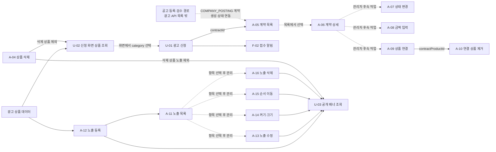

# 광고 상품·계약·노출 API 요청·응답 명세안

- 작성일: 2026-11-07, 한국 시간
- 상태: P-01~P-07 구현 및 scoped 테스트 검증 완료, F-01은 업무 규칙 미정으로 보류
- 확정 기준: 사용자가 제시한 DB와 개발 API 목록
- DB·core 기준: `9a975b354d9b748277725a8a3116b0ff6563c486`
- 관련 맥락: [광고 비즈니스 맥락](2026-11-07-advertisement-business-context.md)

## 1. 확정 범위와 확정 가능성

DB·도메인·개발 API 19개의 경로와 메서드는 확정 기준이다. 공고 목록·홈의 광고 공고 연동과 계약 신청 Slack·메일 알림도 개발 작업에 포함한다. 목 UI의 주차 예약·쿠폰·8단계 영업 진행·가입 동시 처리·임시저장·성과 리포트는 미정이다.

P-01의 다섯 API(U-02, A-01~A-04), P-02의 세 API(U-01, A-05, A-06), P-03의 네 API(A-07~A-10), P-04의 두 API(A-11·A-12), P-05의 U-03은 구현 및 HTTP 계약 검증을 완료했다. P-06 A-13~A-16의 공통 상품 잠금과 형제 current read도 구현·검증했고, P-07은 U-01 저장 후 Slack·메일 알림을 추가했다. P-06 관리자 controller 13건, service 단위 테스트 11건, service DB 테스트 2건, OpenAPI 22건, core 노출 영속성 17건(총 65건)이 통과했다. DB 회귀 테스트는 H2에서 수행했으며 운영 MySQL 인스턴스는 사용하지 않았다. 교차 필드 경합 회귀는 READ_COMMITTED, 삭제 상품 snapshot 회귀는 REPEATABLE_READ로 실행했다. H2 결과는 MySQL InnoDB의 REPEATABLE_READ 동작을 직접 검증하지 않는다. F-01은 업무 규칙이 미정이라 보류한다. 아래 ‘확정 가능성’은 API 존재 여부가 아니라 각 API의 설계를 뒷받침하는 근거의 충분함을 뜻한다.

| 등급 | 판정 기준 |
| --- | --- |
| 높음 | DB·core에 입력·동작·출력이 있고 기존 HTTP 규칙으로 구성 가능. 새 표현 이름 등 소규모 설계 선택은 남음 |
| 중간 | 주요 입력·동작은 있지만 공개 응답, 검증·연동, 연결 데이터 정책을 새로 정해야 함 |
| 낮음 | 자리·호출 대상·조합 정책처럼 Request·Response를 결정할 핵심 업무 규칙이 미정 |

이 문서에서 ‘확정’은 DB·core 및 사용자 지정 범위에만 사용한다. ‘제안’은 이번 요청으로 구성한 신규 HTTP 계약이다. 높음 등급도 배포 완료나 최종 승인 상태를 뜻하지 않는다.

### Request·Response 신뢰도 분리

아래 API별 기존 등급은 기능 전체의 확정 가능성이다. Request와 Response 등급은 각각 JSON 계약이 DB·core·기존 HTTP 규칙에 의해 어느 정도 뒷받침되는지 따로 평가한다. 등급은 통계적 확률이 아니다.

| 등급 | Request·Response 근거 기준 |
| --- | --- |
| 높음 | 필드와 핵심 의미가 DB·core DTO·reader 또는 기존 공통 HTTP 규칙에서 확인된다. 새 컨트롤러에서 이름·상태 코드를 연결하는 작업은 남는다. |
| 중간 | 핵심 데이터는 확인되지만 JSON 평탄화·응답 투영·선택적 null 처리 등 HTTP 계약 결정을 포함한다. |
| 낮음 | UI 관찰이나 가정에 주로 기대며, DB·core만으로 필드 또는 의미를 정할 수 없다. |

UI에서만 관찰된 주차 예약·쿠폰·가입 동시 처리 등의 필드는 아래 Request·Response 설계에 넣지 않았다. 따라서 UI를 참고했다는 이유만으로 등급을 낮춘 항목은 없고, DB·core와 HTTP 표현 사이의 미결 선택만 중간으로 표시했다.

| ID | 메서드·경로 | Request 신뢰도 | Response 신뢰도 | 분리 근거 |
| --- | --- | --- | --- | --- |
| U-01 | `POST /api/v1/advertisement-contracts` | 중간 | 높음 | 입력 필드는 core 신청 DTO와 대응한다. HTTP(S) URL·이메일 검증과 선택 인증을 구현했고 생성 ID는 core Appender가 반환한다. |
| U-02 | `GET /api/v1/advertisement-products` | 높음 | 높음 | 기본 `page=1`, `size=10`으로 미삭제 상품을 페이지 조회하고 공통 `PageResponse`를 반환한다. |
| U-03 | `GET /api/v1/advertisement-exposures?position=...&page=1&size=10` | 높음 | 높음 | position enum과 페이지 응답, 다섯 공개 필드가 구현·계약 검증에 반영됐다. 공개 링크는 A-12 입력 정책을 그대로 따른다. |
| U-04 | `GET /api/v1/users/me/advertisement-contracts?page=1&size=10` | 높음 | 높음 | 회원 식별자·APPLICATION_FORM 조건을 core 목록 조회에 더했고 페이지 형식은 기존 PageResponse를 따른다(LC-3590). |
| U-05 | `GET /api/v1/users/me/advertisement-contracts/{contractId}` | 높음 | 높음 | 신청 폼 필드와 A-06의 계약 상품 표현을 재사용하고 운영자 전용 필드를 뺐다(LC-3590). |
| A-01 | `GET /api/v1/admin/advertisement-products` | 높음 | 높음 | 기본 `page=1`, `size=10`으로 상품을 페이지 조회하고 공통 `PageResponse`를 반환한다. |
| A-02 | `POST /api/v1/admin/advertisement-products` | 높음 | 높음 | 생성 입력 필드·domain 제약과 생성 ID가 core에 대응한다. |
| A-03 | `PUT /api/v1/admin/advertisement-products/{productId}` | 높음 | 높음 | core의 수정 동작과 P-01에서 정한 기존 노출 영향 정책을 따른다. position·price 누락 또는 null은 해제한다. 응답은 공통 성공 규칙을 따른다. |
| A-04 | `DELETE /api/v1/admin/advertisement-products/{productId}` | 높음 | 높음 | 경로 ID로 소프트 삭제하고 공통 성공 규칙을 적용한다. |
| A-05 | `GET /api/v1/admin/advertisement-contracts` | 높음 | 높음 | 필터·기간·정렬은 core 조회 조건, 페이지 형식은 기존 PageResponse 규칙에 대응한다. |
| A-06 | `GET /api/v1/admin/advertisement-contracts/{contractId}` | 높음 | 높음 | 계약 필드·카테고리·연결 상품 표현이 core 상세 DTO에 정의돼 있다. |
| A-07 | `PATCH /api/v1/admin/advertisement-contracts/{contractId}/status` | 높음 | 높음 | 상태 enum·변경 제한·오류가 domain에 정의돼 있다. |
| A-08 | `PATCH /api/v1/admin/advertisement-contracts/{contractId}/payment-amount` | 높음 | 높음 | nullable 정수 금액과 필수 키·null 해제 규칙을 채택해 요청 검증과 OpenAPI에 반영했다. |
| A-09 | `POST /api/v1/admin/advertisement-contracts/{contractId}/products` | 높음 | 높음 | productId 입력, 연결 행 ID와 중복 연결 규칙이 core로 확인된다. |
| A-10 | `DELETE /api/v1/admin/advertisement-contracts/{contractId}/products/{contractProductId}` | 높음 | 높음 | 계약·연결 행 경로와 소프트 삭제가 core에 대응한다. |
| A-11 | `GET /api/v1/admin/advertisement-exposures?productId=&contractId=&page=1&size=10` | 높음 | 중간 | 필터와 페이지 응답·노출 원본은 core에 있다. 제안한 광고주 회사명 파생 필드는 별도 조회 투영이다. |
| A-12 | `POST /api/v1/admin/advertisement-exposures` | 높음 | 높음 | 평탄화 요청·category별 콘텐츠 및 URL 검증과 생성 응답 `data.id`를 P-04에서 구현·계약 검증했다. JOB_POSTING 대상 공고의 실제 적격성 확인은 별도 업무 규칙으로 미정이다. |
| A-13 | `PUT /api/v1/admin/advertisement-exposures/{exposureId}` | 중간 | 높음 | 배너 URL·카테고리별 HTTP 검증은 A-12에서 채택해 테스트했다. PUT의 nullable 필드 누락·null은 전체 교체 값으로 적용하고 테스트했다. 중간은 JOB_POSTING 대상 공고의 실제 존재·게시·마감/노출 적격성 검증 규칙이 미정인 점에만 남긴다. |
| A-14 | `PATCH /api/v1/admin/advertisement-exposures/{exposureId}/exposed` | 높음 | 높음 | boolean 상태 변경과 core 동작이 일치한다. |
| A-15 | `POST /api/v1/admin/advertisement-exposures/{exposureId}/move` | 높음 | 높음 | UP·DOWN 입력, 인접 이동과 경계 동작이 core에 구현돼 있다. |
| A-16 | `DELETE /api/v1/admin/advertisement-exposures/{exposureId}` | 높음 | 높음 | 경로 ID 기반 소프트 삭제와 공통 성공 규칙을 사용한다. |

HTTP API 21개 중 Request는 높음 19개·중간 2개, Response는 높음 20개·중간 1개다. 낮음은 없다. 낮음인 F-01은 아직 경로와 노출 조합 규칙이 없는 광고 공고 연동 작업이며, Request·Response 계약을 정할 수 있는 단계가 아니다.

### API별 요약

| ID | 메서드 | 경로 | 확정 가능성 | 확정 근거·남은 선택 |
| --- | --- | --- | --- | --- |
| U-01 | POST | `/api/v1/advertisement-contracts` | 중간 | 폼 입력·상태는 core DTO를 따른다. HTTP 검증·선택 인증은 P-02에서 정해 구현했고 접수 알림은 P-07에서 응답 변경 없이 연결했다. |
| U-02 | GET | `/api/v1/advertisement-products` | 높음 | 삭제 제외·정렬·출력 원본이 상품 reader와 DB에서 바로 정해진다. |
| U-03 | GET | `/api/v1/advertisement-exposures` | 높음 | 필수 position, 여섯 BANNER 자리, 다섯 공개 필드와 페이지 응답, 빈 결과와 BAD_REQUEST 동작을 구현·계약 검증했다. 링크는 A-12 정책을 따른다. |
| U-04 | GET | `/api/v1/users/me/advertisement-contracts` | 높음 | 로그인 회원의 APPLICATION_FORM 신청만 최신순 페이지로 준다. 반복 `status` 필터를 둔다. |
| U-05 | GET | `/api/v1/users/me/advertisement-contracts/{contractId}` | 높음 | 내 신청이 아니면 없는 계약과 같이 404다. 연결 상품은 A-06과 같이 지운 상품도 표시한다. |
| A-01 | GET | `/api/v1/admin/advertisement-products` | 높음 | 상품 reader에 조회·정렬 규칙이 있고 목록 목적이 명확하다. |
| A-02 | POST | `/api/v1/admin/advertisement-products` | 높음 | 저장 DTO가 4개 필드를 그대로 정의하고 domain 검증이 존재한다. |
| A-03 | PUT | `/api/v1/admin/advertisement-products/{productId}` | 높음 | core 수정 동작을 따르며, 기존 노출이 있어도 category·position 변경을 허용하고 기존 exposure 행은 product 참조를 유지한다. position·price 누락 또는 null은 해제한다. |
| A-04 | DELETE | `/api/v1/admin/advertisement-products/{productId}` | 높음 | 상품 소프트 삭제와 삭제 뒤 조회 제외가 reader·manager에 명시돼 있다. |
| A-05 | GET | `/api/v1/admin/advertisement-contracts` | 높음 | 필터 조건·AND/OR·기간·정렬·페이징을 core 조회와 기존 PageResponse로 구성할 수 있다. |
| A-06 | GET | `/api/v1/admin/advertisement-contracts/{contractId}` | 높음 | 계약 전체 필드와 계약 상품 DTO·삭제 상품 표시가 코드로 정해진다. |
| A-07 | PATCH | `/api/v1/admin/advertisement-contracts/{contractId}/status` | 높음 | 허용 상태·source 제한·409 오류가 domain에 명시돼 있다. |
| A-08 | PATCH | `/api/v1/admin/advertisement-contracts/{contractId}/payment-amount` | 높음 | 계약에 하나인 nullable Int 금액과 변경 메서드가 있다. |
| A-09 | POST | `/api/v1/admin/advertisement-contracts/{contractId}/products` | 높음 | 독립 연결 행 ID·동일 상품 중복 허용·소프트 삭제가 core DTO와 manager로 정해진다. |
| A-10 | DELETE | `/api/v1/admin/advertisement-contracts/{contractId}/products/{contractProductId}` | 높음 | 연결 ID·소속 확인·이미 제거된 행의 조회 제외가 core에 있다. |
| A-11 | GET | `/api/v1/admin/advertisement-exposures` | 중간 | raw 목록·필터는 core로 정해지지만 광고주 표시 이름을 추가하는 응답은 새 설계다. |
| A-12 | POST | `/api/v1/admin/advertisement-exposures` | 중간 | 평탄화 요청·category별 콘텐츠와 URL 검증·생성 응답 `data.id`는 P-04에서 구현했다. 등록 시 JOB_POSTING 대상의 실제 존재·게시·마감/노출 적격성 검증 여부, 책임·시점·오류 계약은 미정이다. |
| A-13 | PUT | `/api/v1/admin/advertisement-exposures/{exposureId}` | 중간 | 배너 URL·카테고리별 HTTP 검증은 A-12에서 채택해 테스트했고, nullable 필드 누락·null의 전체 교체 의미도 구현·테스트했다. 중간은 JOB_POSTING 대상 공고의 실제 존재·게시·마감/노출 적격성 검증 규칙이 미정인 점에만 남긴다. |
| A-14 | PATCH | `/api/v1/admin/advertisement-exposures/{exposureId}/exposed` | 높음 | 독립 boolean 변경이며 core가 동일 상태 변경을 허용한다. |
| A-15 | POST | `/api/v1/admin/advertisement-exposures/{exposureId}/move` | 높음 | UP·DOWN의 인접 교환과 경계 no-op가 core에 구현돼 있다. |
| A-16 | DELETE | `/api/v1/admin/advertisement-exposures/{exposureId}` | 높음 | 미삭제 행 조회와 소프트 삭제가 core로 정해진다. |

HTTP API 21개 중 높음 17개, 중간 4개다. 낮음은 아직 HTTP 경로가 정해지지 않은 광고 공고 연동 F-01에 해당한다. 근거가 충분한 API를 등급 분포 때문에 낮음으로 내리지 않는다.

| 연동 작업 | 확정 가능성 | Request·Response 결정 범위 |
| --- | --- | --- |
| F-01 광고 공고를 목록·홈에 섞기 | 낮음 | 기존 조회 API의 광고 카드 메타데이터 안만 제시. 자리·대상 API·페이징은 미정 |
| F-02 계약 신청 Slack·메일 알림 | 중간 | U-01 요청·201 응답을 유지한다. 수신자·개인정보 범위·실패 정책은 구현 선택을 아래에 기록했다. |

## 2. 공통 HTTP 계약

### 2.1 인증·파라미터

| 이름 | 위치 | 타입 | 필수 | 기본값 | 허용 값 | 설명 |
| --- | --- | --- | --- | --- | --- | --- |
| Authorization | header | string | 관리자: 필수 / U-01~U-03: 선택 / U-04·U-05: 필수 | 없음 | Bearer {오공고 access token} | 관리자 API는 활성 ADMIN. 공개 API는 비회원 허용 |

- U-01~U-03은 비회원 접근을 허용하도록 Security 매핑을 구현했다. U-01은 선택 토큰을 받고, 토큰이 없거나 유효하지 않아도 비회원으로 접수한다.
- U-04·U-05는 GET 메서드와 경로를 좁혀 로그인을 요구한다. 토큰이 없거나 유효하지 않으면 401 `UNAUTHORIZED`다.
- 관리자 API는 관리자 호스트의 `/api/v1/admin/**`에서 활성 ADMIN 계정의 오공고 access token을 요구한다.
- Path·query ID는 양수 int64이고 JSON 식별자도 숫자로 반환한다.
- JSON 요청에는 `Content-Type: application/json`을 사용한다. GET·DELETE 본문은 보내지 않는다.
- enum은 숫자 code나 한글 desc 대신 enum 이름 문자열로 주고받는다.
- 성공 상태는 조회·수정·삭제·이동 200, 새 계약·상품·계약 상품·노출 생성 201이다.

### 2.2 성공·실패 본문

모든 예시는 기존 성공 래퍼 `{status, message, data}`를 포함한다. 반환값 없는 성공도 200과 `data: null`이다. 페이지 적용 목록은 `data: {items, pageInfo}`를 반환하고, 페이지 없는 목록은 `data` 자체가 배열이다. 목록이 비면 배열 또는 `items`가 `[]`다.

U-02, U-03, U-04, A-01, A-11은 외부 `page`를 1부터 받고 기본 `page=1`, `size=10`을 적용한다. `size`는 1~100이며 core 내부에서는 0부터 계산한다. 다른 API의 페이지 규칙은 각 절에 적힌 값을 따른다.

```json
{
  "status": 200,
  "message": "요청이 성공했습니다.",
  "data": null
}
```

실패는 기존 `{status, code, message}`이며 `data`는 넣지 않는다.

```json
{
  "status": 400,
  "code": "BAD_REQUEST",
  "message": "잘못된 요청입니다."
}
```

광고 API Request DTO 검증과 400 오류 응답 매핑은 구현했다. 요청 필드 검증 실패는 필드별 `[필드명] 검증 메시지` 형식의 400 `BAD_REQUEST`로, JSON·타입·enum 파싱 오류는 기본 메시지의 400 `BAD_REQUEST`로 반환한다. U-01은 Request DTO의 Bean Validation과 API 계약의 `@Valid`를 적용하며, HTTP(S) 절대 URL·이메일·필수값·길이·카테고리 제약을 검증한다.

관리자 API의 인증 오류는 모두 동일하다. API별 예외 절에도 이 공통 계약을 적용한다.

| 상황 | status | code | message |
| --- | --- | --- | --- |
| 토큰 없음·유효하지 않음 | 401 | `UNAUTHORIZED` | 리소스 접근 권한이 없습니다. |
| 인증됐지만 관리자 권한 없음 | 403 | `FORBIDDEN` | 리소스 접근 권한이 없습니다. |

API별 도메인 오류의 code·message는 기준 커밋에 실제 존재하는 값을 사용했다. Request validation·새 URL 정책의 구체 메시지는 최종 문구가 확정된 것으로 보지 않는다. 여러 오류가 겹칠 때 어떤 검증이 먼저 실패할지는 이 문서에서 고정하지 않는다.

### 2.3 값·시간·누락 규칙

- 날짜는 `YYYY-MM-DD`, 일시는 `YYYY-MM-DDTHH:mm:ss[.fraction]` ISO-8601이다. 업무·저장 기준은 Asia/Seoul이고 LocalDateTime에 Z·offset을 임의로 추가하지 않는다.
- 선택 문자열·ID·가격·기간의 누락과 null은 각 API 표에 따른다. required boolean에는 기본값을 두지 않는다.
- 빈 문자열은 null과 다르다. 폼의 scheduleRequest·advertisementRequest만 공백을 null로 정리하는 core 동작이 있다.
- PUT은 명시된 수정 필드 전체를 교체한다. nullable 선택 필드의 누락은 값 해제로 제안한다. PATCH nullable 금액은 키 존재와 명시적 null을 구분한다.
- 생성 응답은 `data.id`만 반환하는 안이다. 각 API에서 이 ID가 어떤 리소스인지 명시한다.
- `registeredAt`은 DB·entity의 `createdAt`에 대응하는 외부 별칭 제안이다. 기존 광고 문의 응답과 맞췄다.
- 예시의 ID·금액·일시는 설명용이며 서로 독립된 스냅샷이다.

## 3. enum 계약

| 이름 | 허용 값 |
| --- | --- |
| AdvertisementProductCategory | `JOB_POSTING`, `BANNER`, `INSTAGRAM_1`, `INSTAGRAM_2`, `KAKAO_1`, `KAKAO_2`, `KAKAO_CRM`(2026-11-09 추가, LC-3589) |
| AdvertisementProductPosition | `JOB_HOME_TOP_BANNER`, `JOB_HOME_BOTTOM_BANNER`, `JOB_DETAIL_BANNER`, `BOOTCAMP_LIST_TOP_BANNER`, `BOOTCAMP_LIST_BOTTOM_BANNER`, `BOOTCAMP_DETAIL_BANNER` |
| AdvertisementContractSource | `APPLICATION_FORM`, `COMPANY_POSTING` |
| AdvertisementContractStatus | `REQUESTED`, `NEGOTIATING`, `APPROVED`, `REJECTED` |
| AdvertisementContractPromotionTarget | `JOB`, `BOOTCAMP` |
| AdvertisementContractPurpose | `FAST_APPLICANTS`, `FIT_APPLICANTS`, `BRAND_AWARENESS` |
| AdvertisementContractInvoiceMethod | `TAX_INVOICE`, `NEGOTIATE` |
| AdvertisementContractCreativeMethod | `REQUEST_PRODUCTION`, `PROVIDE_DIRECTLY` |
| AdvertisementExposureTargetType | `JOB`, `BOOTCAMP` |
| AdvertisementExposureMoveDirection | `UP`, `DOWN` |

position 6개는 모두 BANNER 소속이다. JOB_POSTING의 구체적인 position은 아직 없다. INSTAGRAM·KAKAO의 실제 채널 명칭은 미정이다. 기존 enum 선택지 API의 name을 사용하고, UI 문구·목 구좌 코드·숫자 code를 그대로 전달하지 않는다.

## 4. 요청·응답 상세

### U-01. 광고 신청 등록

```http
POST /api/v1/advertisement-contracts
```

확정 가능성: 중간. 폼 입력·상태는 core DTO로 정해진다. HTTP 검증·선택 인증은 P-02에서 채택해 구현했고, 접수 알림은 P-07에서 부수 효과로 연결했다. Request·201 응답 계약은 유지한다.

인증: 비회원 허용, Bearer 선택.

요청 JSON:

```json
{
  "promotionTarget": "JOB",
  "companyName": "샘플기업",
  "recruitmentTitle": "백엔드 인턴 채용",
  "recruitmentUrl": "https://example.com/recruit/backend",
  "recruitmentDeadline": "2026-12-31",
  "purpose": "FIT_APPLICANTS",
  "budgetAmount": 1500000,
  "categories": [
    "BANNER",
    "INSTAGRAM_1"
  ],
  "scheduleRequest": "11월 중 1주 집행을 희망합니다.",
  "advertisementRequest": "인턴 지원자를 대상으로 알려주세요.",
  "managerName": "김담당",
  "email": "marketing@example.com",
  "phoneNumber": "02-1234-5678",
  "invoiceMethod": "TAX_INVOICE",
  "creativeMethod": "REQUEST_PRODUCTION"
}
```

성공 응답: 201

```json
{
  "status": 201,
  "message": "요청이 성공했습니다.",
  "data": {
    "id": 1001
  }
}
```

요청 필드:

| JSON 경로 | 타입 | 필수 | 길이·범위 | 허용 조건 | null·빈 값 |
| --- | --- | --- | --- | --- | --- |
| promotionTarget | string(enum) | 예 | JOB, BOOTCAMP | 홍보 대상 유형 | 누락·null·빈 문자열 불가 |
| companyName | string | 예 | 1~150자 | 공백만으로 구성 불가 | 누락·null·빈 문자열 불가 |
| recruitmentTitle | string | 예 | 1~255자 | 공백만으로 구성 불가 | 누락·null·빈 문자열 불가 |
| recruitmentUrl | string | 예 | 1~2000자 | 공백 불가. HTTP(S) 절대 URL 형식을 검증 | 누락·null·빈 문자열 불가 |
| recruitmentDeadline | string(date) | 예 | YYYY-MM-DD | 과거일·당일을 별도로 금지하지 않음 | 누락·null·빈 문자열 불가 |
| purpose | string(enum) | 예 | 광고 목적 3종 | enum 절 참조 | 누락·null 불가 |
| budgetAmount | int32 | 아니오 | 예정 예산(원) | 1 이상 정수. 0 이하는 400 `BAD_REQUEST` | 누락·null은 null 저장. 구간(budgetRange)을 대신한다 |
| categories[] | string(enum)[] | 예 | 하나 이상, 현재 고유값 최대 7종 | 각 원소는 상품 category. 중복은 Set처럼 제거 | 누락·null·빈 배열·null 원소 불가 |
| scheduleRequest | string | 아니오 | 2000자 이하 | 희망 일정의 자유 텍스트 | 누락·null·공백 문자열은 null 저장 |
| advertisementRequest | string | 아니오 | 2000자 이하 | 광고 요청사항의 자유 텍스트 | 누락·null·공백 문자열은 null 저장 |
| managerName | string | 예 | 1~50자 | 공백만으로 구성 불가 | 누락·null·빈 문자열 불가 |
| email | string | 예 | 1~255자 | 공백 불가. 이메일 형식을 검증 | 누락·null·빈 문자열 불가 |
| phoneNumber | string | 예 | 1~20자 | 전화 정규식은 추가하지 않음. 대표번호·내선 표기 허용 | 누락·null·빈 문자열 불가 |
| businessNumberType | string(enum) | 아니오 | BUSINESS_REGISTRATION, CORPORATE_REGISTRATION, OVERSEAS | 기업 회원가입과 같은 규칙(LC-3589). OVERSEAS면 businessNumber를 보내지 않음 | 누락·null이면 사업자 번호 없음 |
| businessNumber | string | 아니오 | 13자 이하, 숫자만 | businessNumberType 없이 보낼 수 없음. 사업자등록번호 10자리, 법인등록번호 13자리 | 누락·null 허용 |
| invoiceMethod | string(enum) | 예 | TAX_INVOICE, NEGOTIATE | 청구·영수가 아님 | 누락·null 불가 |
| creativeMethod | string(enum) | 예 | REQUEST_PRODUCTION, PROVIDE_DIRECTLY | 소재 준비 방식 | 누락·null 불가 |
| formAnswers[] | object[] | 아니오 | 최대 30개 | 칸이 따로 없는 폼 문항(희망 상품, 희망 기간, 모집 형태 등)의 답. 보낸 순서를 그대로 저장한다. key의 뜻은 검사하지 않는다(LC-3607) | 누락·null·빈 배열은 null 저장. null 원소 처리는 확인 필요 |
| formAnswers[].key | string | 예 | 1~50자 | 공백만으로 구성 불가. FE가 정하는 문항 키 | 누락·null·빈 문자열 불가 |
| formAnswers[].label | string | 예 | 1~50자 | 공백만으로 구성 불가. 신청 당시 화면에 보인 문항 이름 | 누락·null·빈 문자열 불가 |
| formAnswers[].value | string | 예 | 1~1000자 | 공백만으로 구성 불가. 여러 개를 고른 문항은 FE가 한 문자열로 합친다 | 누락·null·빈 문자열 불가 |

응답 필드:

| JSON 경로 | 타입 | nullable | 설명 |
| --- | --- | --- | --- |
| data.id | int64 | 아니오 | 새 APPLICATION_FORM 계약 ID |

동작과 경계:

- source=APPLICATION_FORM, status=REQUESTED, targetId=null, paymentAmount=null을 서버가 정한다. source·status·targetId·userId·paymentAmount·productIds는 요청 계약에 넣지 않는다.
- 유효한 토큰의 회원 ID가 회원 테이블에 있으면 연결한다. 토큰이 없거나 유효하지 않거나 토큰의 회원 행이 없으면 비회원으로 접수한다. 토큰 검증 실패 시 Security filter는 인증을 비우고 요청을 계속 진행하며, U-01은 `permitAll`이다.
- 희망 categories만 저장한다. 실제 상품 연결과 노출 생성은 각각 어드민 API로 수행한다. 신청으로 계정·공고·결제·구좌 예약을 자동 생성하지 않는다.
- 신청 원문을 보존한다. 필수 문자열을 전역 trim하지 않는다. scheduleRequest·advertisementRequest만 공백일 때 null로 정리한다.
- formAnswers는 `advertisement_contracts.form_answers` JSON 칸에 `[{ key, label, value }]` 목록으로 저장한다(LC-3607). 폼 문항이 자주 바뀌어 문항마다 칸을 두지 않는다. 이 칸이 생기기 전 신청의 scheduleRequest에 `[희망 상품] ...`처럼 섞인 값은 옮기지 않으며, 기존 행의 form_answers는 null이다. scheduleRequest는 이제 신청자가 적은 일정 메모만 담는다. 이 저장소에서 MySQL `JSON` 칸을 쓰는 첫 사례이며(Hibernate `@JdbcTypeCode(SqlTypes.JSON)`), JSON 칸을 언제 쓸지에 대한 일반 규칙은 확인 필요다.
- 반복 POST는 서로 다른 계약을 만든다. source·target 유니크 제약은 targetId가 null인 폼 중복 제출을 막지 않는다.
- 계약 저장 뒤 알림 적재를 별도 트랜잭션으로 시도한다. 공통 notification 대기열에 신청자 EMAIL과 영업 SLACK 행을 넣으며, 실제 발송은 공통 dispatcher가 처리한다. 계약 ID별 deduplication key로 중복 행을 막는다. 대기열 적재 실패도 접수 성공 응답을 바꾸지 않으며 U-01은 기존 `data.id`를 반환한다. 실제 전달은 응답에서 보장하지 않는다.
- U-01은 Request DTO 검증과 기존 사용자 API 예외 처리기를 사용한다. 필드 제약 오류는 필드명을 포함한 400 `BAD_REQUEST`, JSON·enum 등 역직렬화 오류는 기본 문구의 400 `BAD_REQUEST`로 매핑한다. 이 동작은 컨트롤러 계약 테스트에 포함돼 있다.

#### 예외

| 상황 | status | code | message |
| --- | --- | --- | --- |
| 입력 누락·타입·enum·길이·범위·형식 오류 | 400 | `BAD_REQUEST` | `잘못된 요청입니다.` 또는 `[필드] 검증 메시지` |

**구현 선택 (2026-11-08):** HTTP(S) 절대 URL과 이메일 형식을 검증한다. 토큰이 없거나 유효하지 않거나 해당 회원 행이 없으면 비회원으로 접수한다. 토큰 검증 실패 시 Security filter가 기존 정책대로 인증을 비우고 요청을 계속 진행하며, 이 경로는 `permitAll`이다. A-05 query 이름은 `source`, 반복 `status`, `promotionTarget`, `category`, `companyName`, `createdFrom`, `createdTo`로 사용하고 외부 페이지 기본값은 `page=1`, `size=20`이다. 접수 Slack·메일 정책은 F-02 구현 선택을 따른다.

### U-02. 신청 화면 상품 목록 조회

```http
GET /api/v1/advertisement-products
```

확정 가능성: 높음. 삭제 제외·정렬·출력 원본이 상품 reader와 DB에서 바로 정해진다.

인증: 비회원 허용.

요청 본문 없음. `page`와 `size`는 선택이며 기본값은 각각 1과 10, 최대 size는 100이다.

| 이름 | 위치 | 타입 | 필수 | 기본값 | 허용 값 | 설명 |
| --- | --- | --- | --- | --- | --- | --- |
| page | query | int32 | 아니오 | 1 | 1 이상 | 외부 페이지 번호 |
| size | query | int32 | 아니오 | 10 | 1~100 | 페이지 크기 |

성공 응답: 200

```json
{
  "status": 200,
  "message": "요청이 성공했습니다.",
  "data": {
    "items": [
      {
        "id": 11,
        "category": "BANNER",
        "position": "JOB_HOME_TOP_BANNER",
        "name": "채용공고 홈 상단 배너",
        "price": 500000
      }
    ],
    "pageInfo": { "pageNum": 1, "pageSize": 10, "totalElements": 1, "totalPages": 1 }
  }
}
```

응답 필드:

| JSON 경로 | 타입 | nullable | 설명 |
| --- | --- | --- | --- |
| data.items[].id | int64 | 아니오 | 상품 ID |
| data.items[].category | string(enum) | 아니오 | 상품 카테고리 |
| data.items[].position | string(enum) | 예 | 노출 자리. 외부 채널·자리 미정 상품은 null |
| data.items[].name | string | 아니오 | 상품명 |
| data.items[].price | int32 | 예 | 소개 가격. null은 견적 문의, 0과 다름 |
| data.pageInfo.pageNum | int32 | 아니오 | 1부터 시작하는 요청 페이지 |
| data.pageInfo.pageSize | int32 | 아니오 | 요청 페이지 크기 |
| data.pageInfo.totalElements | int64 | 아니오 | 미삭제 상품 수 |
| data.pageInfo.totalPages | int32 | 아니오 | 전체 페이지 수, 결과가 없으면 0 |

동작과 경계:

- 본문·필터는 없다. `page` 기본 1, `size` 기본 10·최대 100이다. 미삭제 상품 중 요청 페이지를 category 선언 순서, id 오름차순으로 반환한다. 없으면 `items=[]`다.
- position·price는 null일 수 있다. 소개 가격이며 계약별 실제 금액이 아니다. 노출 불가능한 인스타그램·카카오톡 상품도 포함한다.
- 선택은 categories로 U-01에 보낸다. 이 API의 상품 ID를 신청자가 계약에 바로 붙이는 방식으로 해석하지 않는다.

#### 예외

추가 도메인 예외 없음. 빈 결과는 정상 200이다.

### U-03. 자리별 노출 중인 배너 조회

```http
GET /api/v1/advertisement-exposures?position=JOB_HOME_TOP_BANNER&page=1&size=10
```

확정 가능성: 높음. 조회·정렬은 core가 제공하며 공개 필드와 링크 처리를 P-05에서 확정해 구현했다.

인증: 비회원 허용.

요청 본문 없음.

성공 응답: 200

```json
{
  "status": 200,
  "message": "요청이 성공했습니다.",
  "data": {
    "items": [
      {
        "id": 501,
        "name": "샘플기업 인턴 채용",
        "imageUrl": "https://example.com/assets/banner.png",
        "linkUrl": "/jobs/5501",
        "adLabel": true
      }
    ],
    "pageInfo": { "pageNum": 1, "pageSize": 10, "totalElements": 1, "totalPages": 1 }
  }
}
```

요청 파라미터:

| 이름 | 위치 | 타입 | 필수 | 기본값 | 허용 값 | 설명 |
| --- | --- | --- | --- | --- | --- | --- |
| position | query | string(enum) | 예 | 없음 | 현재 배너 position 6종 | 고정된 화면 자리. productId로 요청하지 않음 |
| page | query | int32 | 아니오 | 1 | 1 이상 | 외부 페이지 번호 |
| size | query | int32 | 아니오 | 10 | 1~100 | 페이지 크기 |

응답 필드:

| JSON 경로 | 타입 | nullable | 설명 |
| --- | --- | --- | --- |
| data.items[].id | int64 | 아니오 | 노출 ID |
| data.items[].name | string | 아니오 | 배너 이름 |
| data.items[].imageUrl | string | 아니오 | 배너 이미지 URL |
| data.items[].mobileImageUrl | string | 예 | 모바일 배너 이미지 URL. null이면 모바일에서도 imageUrl을 씀 |
| data.items[].linkUrl | string | 아니오 | 클릭할 외부 URL 또는 내부 경로. A-12 등록 때 허용한 값을 그대로 반환 |
| data.items[].adLabel | boolean | 아니오 | 광고 표시 여부 |
| data.pageInfo.pageNum | int32 | 아니오 | 1부터 시작하는 요청 페이지 |
| data.pageInfo.pageSize | int32 | 아니오 | 요청 페이지 크기 |
| data.pageInfo.totalElements | int64 | 아니오 | 현재 자리에서 보이는 노출 수 |
| data.pageInfo.totalPages | int32 | 아니오 | 전체 페이지 수, 결과가 없으면 0 |

동작과 경계:

- 본문 없음. 현재 position 6종은 모두 BANNER다. 따라서 이 API는 JOB_POSTING 광고를 반환하지 않으며 광고 공고용 자리와 응답은 연동 작업 F-01에서 미정으로 남긴다.
- 서버 Clock의 현재 시각으로 미삭제 상품·미삭제 노출·exposed=true·기간 내 행만 반환한다. 시작·종료 시각은 양 끝을 포함한다. 기간 둘 다 null이면 상시다.
- 동일 position에 여러 상품이 있어도 전체 노출을 displayOrder ASC, id ASC로 정렬한다. 고정 슬롯 수·랜덤·롤링·상위 N개 제한은 추가하지 않는다.
- position은 유효하지만 상품·노출이 없으면 200과 `items=[]`다. 유효하지 않은 position은 400이다. 정렬은 `displayOrder ASC, id ASC`를 유지한다.
- 공개 응답은 `{id, name, imageUrl, mobileImageUrl, linkUrl, adLabel}`만 포함한다. 광고주·상품·계약 ID, 대상 메타데이터, 결제액·기간·연락처는 제외한다. `id`는 노출 ID이지 상품 ID나 계약 ID가 아니다.
- `linkUrl`은 A-12의 HTTP(S) 절대 URL 또는 단일 `/` 내부 경로 허용 정책을 따른다. U-03은 추가 검증·정규화·재작성 정책을 두지 않고 저장된 값을 반환한다.

#### 예외

| 상황 | status | code | message |
| --- | --- | --- | --- |
| 필수 `position` 누락, 잘못된 타입 또는 6종 이외 enum 값 | 400 | `BAD_REQUEST` | `잘못된 요청입니다.` |

P-05에서 U-03 응답·인증·검증·링크 처리 선택은 확정했다. U-03에 남은 별도 선택은 없다. JOB_POSTING 대상의 실재·게시·마감/노출 적격성을 A-12 등록 시 확인할지는 별도 미정 정책이며, 목록·홈의 공개 조합 규칙은 F-01 범위다. 현재 여섯 배너 position 조회에는 JOB_POSTING이 포함되지 않는다. 클릭 집계와 로테이션은 별도 API 작업이다.

### U-04. 내 광고 신청 목록 조회

```http
GET /api/v1/users/me/advertisement-contracts?status=REQUESTED&status=NEGOTIATING&page=1&size=10
```

확정 가능성: 높음. 비즈니스 앱의 광고 신청 내역 화면이 쓴다(LC-3590).

인증: Bearer 필수. 역할은 가리지 않는다. U-01이 로그인한 회원의 신청에 회원 ID를 연결하므로 그 회원이면 누구든 자기 신청을 본다.

요청 파라미터:

| 이름 | 위치 | 타입 | 필수 | 기본값 | 허용 값 | 설명 |
| --- | --- | --- | --- | --- | --- | --- |
| status | query | string(enum), 반복 | 아니오 | 없음 | REQUESTED, NEGOTIATING, APPROVED, REJECTED | 여러 번 보내면 그중 하나인 신청. 보내지 않으면 거르지 않음 |
| page | query | int32 | 아니오 | 1 | 1 이상 | 외부 페이지 번호 |
| size | query | int32 | 아니오 | 10 | 1~100 | 페이지 크기 |

성공 응답: 200

```json
{
  "status": 200,
  "message": "요청이 성공했습니다.",
  "data": {
    "items": [
      {
        "id": 1001,
        "status": "REQUESTED",
        "promotionTarget": "JOB",
        "companyName": "샘플기업",
        "recruitmentTitle": "백엔드 인턴 채용",
        "recruitmentDeadline": "2026-12-31",
        "categories": ["BANNER", "INSTAGRAM_1"],
        "paymentAmount": null,
        "registeredAt": "2026-11-08T10:00:00"
      }
    ],
    "pageInfo": { "pageNum": 1, "pageSize": 10, "totalElements": 1, "totalPages": 1 }
  }
}
```

응답 필드:

| JSON 경로 | 타입 | nullable | 설명 |
| --- | --- | --- | --- |
| data.items[].id | int64 | 아니오 | 계약 ID. U-01이 돌려준 `data.id`와 같다 |
| data.items[].status | string(enum) | 아니오 | 계약 상태 |
| data.items[].promotionTarget | string(enum) | 아니오 | 홍보 대상 유형 |
| data.items[].companyName | string | 아니오 | 신청 때 적은 기업명 |
| data.items[].recruitmentTitle | string | 아니오 | 신청 때 적은 공고명 |
| data.items[].recruitmentDeadline | string(date) | 아니오 | 신청 때 적은 모집 마감일 |
| data.items[].categories[] | string(enum)[] | 아니오 | 신청 때 고른 카테고리, enum 이름순 |
| data.items[].paymentAmount | int32 | 예 | 운영자가 정한 협의 금액. 정하기 전이면 null |
| data.items[].registeredAt | string(date-time) | 아니오 | 신청 일시(KST) |
| data.pageInfo | object | 아니오 | U-03과 같은 페이지 정보 |

동작과 경계:

- 로그인한 회원 ID로 저장된 `APPLICATION_FORM` 계약만 준다. 로그인 없이 낸 신청은 회원 ID가 없어 나오지 않는다. 비즈니스 공고 등록으로 생긴 `COMPANY_POSTING` 계약은 같은 회원 ID를 가져도 넣지 않는다.
- 최근 신청부터(`id DESC`) 준다. 정렬은 고를 수 없다.
- 운영자 전용 값(source, targetId, userId, updatedAt)은 싣지 않는다.

#### 예외

| 상황 | status | code | message |
| --- | --- | --- | --- |
| 페이지 범위 밖 또는 enum에 없는 status | 400 | `BAD_REQUEST` | `잘못된 요청입니다.` 또는 `[파라미터] 검증 메시지` |
| 토큰 없음·만료·위조 | 401 | `UNAUTHORIZED` | `리소스 접근 권한이 없습니다.` |

### U-05. 내 광고 신청 상세 조회

```http
GET /api/v1/users/me/advertisement-contracts/{contractId}
```

확정 가능성: 높음. U-04와 같은 화면의 상세다(LC-3590).

인증: Bearer 필수.

성공 응답: 200

```json
{
  "status": 200,
  "message": "요청이 성공했습니다.",
  "data": {
    "id": 1001,
    "status": "NEGOTIATING",
    "promotionTarget": "JOB",
    "companyName": "샘플기업",
    "recruitmentTitle": "백엔드 인턴 채용",
    "recruitmentUrl": "https://example.com/recruit/backend",
    "recruitmentDeadline": "2026-12-31",
    "purpose": "FIT_APPLICANTS",
    "budgetAmount": 1500000,
    "categories": ["BANNER", "INSTAGRAM_1"],
    "scheduleRequest": "11월 중 1주 집행을 희망합니다.",
    "advertisementRequest": null,
    "managerName": "김담당",
    "email": "marketing@example.com",
    "phoneNumber": "02-1234-5678",
    "businessNumberType": "BUSINESS_REGISTRATION",
    "businessNumber": "1234567890",
    "invoiceMethod": "TAX_INVOICE",
    "creativeMethod": "REQUEST_PRODUCTION",
    "paymentAmount": 300000,
    "registeredAt": "2026-11-08T10:00:00",
    "products": [
      {
        "contractProductId": 31,
        "productName": "채용공고 홈 상단 배너",
        "category": "BANNER",
        "position": "JOB_HOME_TOP_BANNER",
        "productDeleted": false
      }
    ]
  }
}
```

응답 필드:

| JSON 경로 | 타입 | nullable | 설명 |
| --- | --- | --- | --- |
| data.id ~ data.creativeMethod | U-01 요청 필드와 같음 | budgetAmount·scheduleRequest·advertisementRequest·businessNumberType·businessNumber만 예 | 신청 때 보낸 값. 보내지 않은 선택 값과 공백 요청사항은 null로 나온다. 해외 기업은 businessNumber가 null이다 |
| data.formAnswers[] | object[] | 예 | 폼 문항의 답 `{ key, label, value }`, 보낸 순서. 답 없이 낸 신청과 LC-3607 이전 신청은 null. 목록에는 싣지 않는다 |
| data.status | string(enum) | 아니오 | 계약 상태 |
| data.paymentAmount | int32 | 예 | 협의 금액. 정하기 전이면 null |
| data.registeredAt | string(date-time) | 아니오 | 신청 일시(KST) |
| data.products[] | object[] | 아니오 | 운영자가 붙인 상품, 붙인 순서. 없으면 `[]` |
| data.products[].contractProductId | int64 | 아니오 | 연결 행 ID. 같은 상품을 두 번 붙이면 둘이다 |
| data.products[].productName | string | 아니오 | 조회 시점의 상품 이름 |
| data.products[].category | string(enum) | 아니오 | 조회 시점의 상품 카테고리 |
| data.products[].position | string(enum) | 예 | 노출 자리. 외부 채널 상품은 null |
| data.products[].productDeleted | boolean | 아니오 | 운영자가 상품을 지웠는지 |

동작과 경계:

- 내 회원 ID로 저장된 `APPLICATION_FORM` 계약만 찾는다. 다른 회원의 신청, 로그인 없이 낸 신청, `COMPANY_POSTING` 계약, 없는 ID는 모두 같은 404로 응답해 계약이 있는지 알리지 않는다.
- 연결 상품은 A-06과 같은 규칙이다. 계약에서 뺀 상품은 주지 않고, 지운 상품은 이름과 `productDeleted=true`로 준다. A-06의 `productId`·`addedAt`은 싣지 않는다.
- 운영자 전용 값(source, targetId, userId, updatedAt)은 싣지 않는다. 노출 설정(A-11)과 기간은 이 API 범위가 아니다.

#### 예외

| 상황 | status | code | message |
| --- | --- | --- | --- |
| contractId가 양수가 아니거나 숫자가 아님 | 400 | `BAD_REQUEST` | `잘못된 요청입니다.` 또는 `[파라미터] 검증 메시지` |
| 토큰 없음·만료·위조 | 401 | `UNAUTHORIZED` | `리소스 접근 권한이 없습니다.` |
| 내 신청이 아니거나 없음 | 404 | `ADVERTISEMENT_CONTRACT_NOT_FOUND` | `광고 계약을 찾을 수 없습니다.` |

### A-01. 어드민 상품 목록 조회

```http
GET /api/v1/admin/advertisement-products
```

확정 가능성: 높음. 상품 reader에 조회·정렬 규칙이 있고 목록 목적이 명확하다.

인증: 관리자 Bearer 필수.

요청 본문 없음. `page`는 기본 1, `size`는 기본 10·최대 100이다.

| 이름 | 위치 | 타입 | 필수 | 기본값 | 허용 값 | 설명 |
| --- | --- | --- | --- | --- | --- | --- |
| page | query | int32 | 아니오 | 1 | 1 이상 | 외부 페이지 번호 |
| size | query | int32 | 아니오 | 10 | 1~100 | 페이지 크기 |

성공 응답: 200

```json
{
  "status": 200,
  "message": "요청이 성공했습니다.",
  "data": {
    "items": [
      {
        "id": 11,
        "category": "BANNER",
        "position": "JOB_HOME_TOP_BANNER",
        "name": "채용공고 홈 상단 배너",
        "price": 500000,
        "registeredAt": "2026-11-07T17:00:00",
        "updatedAt": "2026-11-07T17:00:00"
      }
    ],
    "pageInfo": { "pageNum": 1, "pageSize": 10, "totalElements": 1, "totalPages": 1 }
  }
}
```

응답 필드:

| JSON 경로 | 타입 | nullable | 설명 |
| --- | --- | --- | --- |
| data.items[].id | int64 | 아니오 | 상품 ID |
| data.items[].category | string(enum) | 아니오 | 상품 카테고리 |
| data.items[].position | string(enum) | 예 | 노출 자리. 외부 채널·자리 미정 상품은 null |
| data.items[].name | string | 아니오 | 상품명 |
| data.items[].price | int32 | 예 | 소개 가격. null은 견적 문의, 0과 다름 |
| data.items[].registeredAt | string(date-time) | 아니오 | 생성 일시 |
| data.items[].updatedAt | string(date-time) | 아니오 | 수정 일시 |
| data.pageInfo.pageNum | int32 | 아니오 | 1부터 시작하는 요청 페이지 |
| data.pageInfo.pageSize | int32 | 아니오 | 요청 페이지 크기 |
| data.pageInfo.totalElements | int64 | 아니오 | 미삭제 상품 수 |
| data.pageInfo.totalPages | int32 | 아니오 | 전체 페이지 수, 결과가 없으면 0 |

동작과 경계:

- 본문·필터는 없다. `page` 기본 1, `size` 기본 10·최대 100이다. 미삭제 상품을 category 선언 순서, id ASC로 반환한다. 없으면 `items=[]`다.
- 노출 세팅 탭에서는 JOB_POSTING·BANNER만 사용한다. 외부 채널 상품에도 판매 기록 관리를 위해 목록 항목은 존재한다.
- 상품별 계약 수·노출 수·슬롯 수·쿠폰·판매 단위는 이 응답에 추가하지 않는다. 현재 DB 확정 필드에 없다.

#### 예외

공통 관리자 인증 오류 401·403에 더해 다음을 적용한다.

추가 도메인 예외 없음. 빈 결과는 정상 200이다.

### A-02. 광고 상품 등록

```http
POST /api/v1/admin/advertisement-products
```

확정 가능성: 높음. 저장 DTO가 4개 필드를 그대로 정의하고 domain 검증이 존재한다.

인증: 관리자 Bearer 필수.

요청 JSON:

```json
{
  "category": "BANNER",
  "position": "JOB_HOME_TOP_BANNER",
  "name": "채용공고 홈 상단 배너",
  "price": 500000
}
```

성공 응답: 201

```json
{
  "status": 201,
  "message": "요청이 성공했습니다.",
  "data": {
    "id": 11
  }
}
```

요청 필드:

| JSON 경로 | 타입 | 필수 | 길이·범위 | 허용 조건 | null·빈 값 |
| --- | --- | --- | --- | --- | --- |
| category | string(enum) | 예 | 상품 카테고리 6종 | 현재 enum 이름 | 누락·null·빈 문자열 불가 |
| position | string(enum) | 아니오 | 현재 배너 자리 6종 | 값이 있으면 category와 일치 | 누락·null이면 자리 없음, 빈 문자열 불가 |
| name | string | 예 | 1~100자 | 공백만으로 구성 불가 | 누락·null·빈 문자열 불가 |
| price | int32 | 아니오 | 0~2147483647 | 원 단위 소개 가격 | 누락·null이면 견적 문의, 0은 0원 |

응답 필드:

| JSON 경로 | 타입 | nullable | 설명 |
| --- | --- | --- | --- |
| data.id | int64 | 아니오 | 새 상품 ID |

동작과 경계:

- position=null인 BANNER·JOB_POSTING 상품도 현 core에서 허용한다. 외부 채널 카테고리는 대응 position이 없어 null로 보낸다.
- 중복 상품명·동일 position 상품 등록을 별도로 금지하지 않는다. 소개 가격 null은 견적 문의이고 0과 구분한다.
- 등록 후 상품 목록을 다시 조회하면 category·id 정렬에 맞는 위치에 나타난다.

#### 예외

공통 관리자 인증 오류 401·403에 더해 다음을 적용한다.

| 상황 | status | code | message |
| --- | --- | --- | --- |
| 입력 누락·타입·enum·길이·범위·형식 오류 | 400 | `BAD_REQUEST` | `잘못된 요청입니다.` 또는 `[필드] 검증 메시지` |
| position과 category 불일치 | 400 | `ADVERTISEMENT_PRODUCT_POSITION_MISMATCH` | 노출 자리가 상품 카테고리와 맞지 않습니다. |

### A-03. 광고 상품 전체 수정

```http
PUT /api/v1/admin/advertisement-products/{productId}
```

확정 가능성: 높음. 수정 동작은 core에 정의되어 있고, 기존 노출이 있어도 category·position 변경을 허용하는 정책은 P-01에서 결정했다.

인증: 관리자 Bearer 필수.

요청 JSON:

```json
{
  "category": "BANNER",
  "position": "JOB_HOME_TOP_BANNER",
  "name": "채용공고 홈 상단 배너",
  "price": null
}
```

성공 응답: 200

```json
{
  "status": 200,
  "message": "요청이 성공했습니다.",
  "data": null
}
```

요청 파라미터:

| 이름 | 위치 | 타입 | 필수 | 기본값 | 허용 값 | 설명 |
| --- | --- | --- | --- | --- | --- | --- |
| productId | path | int64 | 예 | 없음 | 1 이상 | 대상 식별자 |

요청 필드:

| JSON 경로 | 타입 | 필수 | 길이·범위 | 허용 조건 | null·빈 값 |
| --- | --- | --- | --- | --- | --- |
| category | string(enum) | 예 | 상품 카테고리 6종 | 현재 enum 이름 | 누락·null·빈 문자열 불가 |
| position | string(enum) | 아니오 | 현재 배너 자리 6종 | 값이 있으면 category와 일치 | 누락·null이면 자리 없음, 빈 문자열 불가 |
| name | string | 예 | 1~100자 | 공백만으로 구성 불가 | 누락·null·빈 문자열 불가 |
| price | int32 | 아니오 | 0~2147483647 | 원 단위 소개 가격 | 누락·null이면 견적 문의, 0은 0원 |

응답 필드:

| JSON 경로 | 타입 | nullable | 설명 |
| --- | --- | --- | --- |
| data | null | 예 | 반환 데이터 없음 |

동작과 경계:

- 상품 4개 필드를 교체한다. category·name은 항상 필요하다. position·price 누락 또는 null은 기존 값을 해제한다.
- P-01은 기존 노출이 있어도 category·position 변경을 허용하기로 결정했다. 구현은 이 결정에 따라 기존 exposure 행을 삭제·재연결하지 않으며, 각 행은 기존 product 참조를 유지한다. 상품명·category는 계약 상세에서도 현재 상품 값으로 보인다.
- A-03은 서비스 트랜잭션 안에서 활성 상품 `readForUpdate`를 사용한다. A-04 삭제와 같은 상품 행 `PESSIMISTIC_WRITE` 잠금을 먼저 얻어 수정과 삭제를 직렬화한다. A-03이 먼저 잠그면 수정 값이 커밋된 뒤 A-04 삭제가 적용되어 수정 필드는 남고 상품은 삭제 상태가 된다. A-04가 먼저 잠그면 A-03은 대기하고, 삭제 커밋 뒤 활성 상품 조회 결과가 없어 404를 반환한다. 따라서 A-03의 오래된 엔티티가 `deletedAt = null`을 다시 기록해 상품을 되살리는 경합을 막는다.
- 상품 삭제 상태는 수정으로 변경하지 않으며 이미 삭제된 상품은 404다. 응답 뒤 상품 목록·관련 노출 목록을 재조회한다.

#### 예외

공통 관리자 인증 오류 401·403에 더해 다음을 적용한다.

| 상황 | status | code | message |
| --- | --- | --- | --- |
| 입력 누락·타입·enum·길이·범위·형식 오류 | 400 | `BAD_REQUEST` | `잘못된 요청입니다.` 또는 `[필드] 검증 메시지` |
| 상품이 없거나 소프트 삭제됨 | 404 | `ADVERTISEMENT_PRODUCT_NOT_FOUND` | 광고 상품을 찾을 수 없습니다. |
| position과 category 불일치 | 400 | `ADVERTISEMENT_PRODUCT_POSITION_MISMATCH` | 노출 자리가 상품 카테고리와 맞지 않습니다. |

### A-04. 광고 상품 삭제

```http
DELETE /api/v1/admin/advertisement-products/{productId}
```

확정 가능성: 높음. 상품 소프트 삭제와 삭제 뒤 조회 제외가 reader·manager에 명시돼 있다.

인증: 관리자 Bearer 필수.

요청 본문 없음.

성공 응답: 200

```json
{
  "status": 200,
  "message": "요청이 성공했습니다.",
  "data": null
}
```

요청 파라미터:

| 이름 | 위치 | 타입 | 필수 | 기본값 | 허용 값 | 설명 |
| --- | --- | --- | --- | --- | --- | --- |
| productId | path | int64 | 예 | 없음 | 1 이상 | 대상 식별자 |

응답 필드:

| JSON 경로 | 타입 | nullable | 설명 |
| --- | --- | --- | --- |
| data | null | 예 | 반환 데이터 없음 |

동작과 경계:

- 본문 없음. 상품 deletedAt을 기록한다. 계약·계약 상품·노출 행은 보존한다.
- A-03 수정, A-04 삭제, A-09 계약 상품 연결은 활성 상품 `readForUpdate`로 같은 상품 행을 먼저 잠근다. A-03과 A-04는 먼저 잠금을 얻은 작업이 커밋된 뒤 다음 작업이 활성 상태를 다시 확인한다. 수정이 먼저면 수정 값을 보존한 채 마지막에 삭제되고, 삭제가 먼저면 대기한 수정은 `ADVERTISEMENT_PRODUCT_NOT_FOUND`로 끝난다. A-09도 삭제가 먼저 커밋된 뒤에는 새 연결을 만들지 못한다.
- 삭제된 상품 자리의 노출은 U-03에서 제외되고, 새 계약 상품·노출 등록이나 노출 본문 수정에 이 상품을 사용할 수 없다.
- 계약 상세의 기존 상품은 productDeleted=true로 계속 보인다. 상품 목록에서는 빠진다.
- reader가 미삭제 상품만 읽으므로 없는 ID와 반복 삭제는 404로 정하는 안이다. 소프트 삭제 자체는 이미 삭제된 객체에 반복 호출해도 최초 시각을 유지한다.

P-01 focused 검증은 관리자 상품 controller 9건, service 단위 2건, A-03/A-04 H2 동시성 2건, 기존 상품·계약 연결 H2 동시성 2건, OpenAPI 22건(총 37건)과 core 상품 영속성 1건이 통과했고 실패·오류·건너뜀은 없었다. 두 A-03/A-04 경합 순서는 latch로 실행 시점을 고정해 검증했다. DB 결과는 H2에 한정되며 운영 MySQL의 동시성 동작을 검증한 것으로 보지 않는다.

#### 예외

공통 관리자 인증 오류 401·403에 더해 다음을 적용한다.

| 상황 | status | code | message |
| --- | --- | --- | --- |
| 입력 누락·타입·enum·길이·범위·형식 오류 | 400 | `BAD_REQUEST` | `잘못된 요청입니다.` 또는 `[필드] 검증 메시지` |
| 상품이 없거나 소프트 삭제됨 | 404 | `ADVERTISEMENT_PRODUCT_NOT_FOUND` | 광고 상품을 찾을 수 없습니다. |

### A-05. 광고 계약 목록 조회

```http
GET /api/v1/admin/advertisement-contracts?page=1&size=20&source=APPLICATION_FORM&status=REQUESTED&status=NEGOTIATING&category=BANNER&createdFrom=2026-11-01&createdTo=2026-11-30
```

확정 가능성: 높음. 필터 조건·AND/OR·기간·정렬·페이징을 core 조회와 기존 PageResponse로 구성할 수 있다.

인증: 관리자 Bearer 필수.

요청 본문 없음.

성공 응답: 200

```json
{
  "status": 200,
  "message": "요청이 성공했습니다.",
  "data": {
    "items": [
      {
        "id": 1001,
        "source": "APPLICATION_FORM",
        "status": "REQUESTED",
        "promotionTarget": "JOB",
        "targetId": null,
        "companyName": "샘플기업",
        "recruitmentTitle": "백엔드 인턴 채용",
        "recruitmentDeadline": "2026-12-31",
        "budgetAmount": 1500000,
        "categories": [
          "BANNER",
          "INSTAGRAM_1"
        ],
        "paymentAmount": null,
        "registeredAt": "2026-11-07T17:30:00",
        "updatedAt": "2026-11-07T17:30:00"
      }
    ],
    "pageInfo": {
      "pageNum": 1,
      "pageSize": 20,
      "totalElements": 1,
      "totalPages": 1
    }
  }
}
```

요청 파라미터:

| 이름 | 위치 | 타입 | 필수 | 기본값 | 허용 값 | 설명 |
| --- | --- | --- | --- | --- | --- | --- |
| page | query | int32 | 아니오 | 1 | 1 이상 | 외부 페이지 번호 |
| size | query | int32 | 아니오 | 20 | 1~100 | 페이지 크기 |
| source | query | string(enum) | 아니오 | 조건 없음 | APPLICATION_FORM, COMPANY_POSTING | 계약 경로 |
| status | query | string(enum)[] | 아니오 | 조건 없음 | 계약 상태 4종 | status=REQUESTED&status=NEGOTIATING 형태. OR |
| promotionTarget | query | string(enum) | 아니오 | 조건 없음 | JOB, BOOTCAMP | 홍보 유형 |
| category | query | string(enum) | 아니오 | 조건 없음 | 상품 category 6종 | 신청 categories 포함 여부. 붙인 상품 필터 아님 |
| companyName | query | string | 아니오 | 조건 없음 | 100자 이하 제안 | 앞뒤 공백 제거, 대소문자 무시 부분 검색 |
| createdFrom | query | string(date) | 아니오 | 조건 없음 | YYYY-MM-DD | 생성일 시작, 당일 포함 |
| createdTo | query | string(date) | 아니오 | 조건 없음 | YYYY-MM-DD | 생성일 끝, 당일 포함 |

응답 필드:

| JSON 경로 | 타입 | nullable | 설명 |
| --- | --- | --- | --- |
| data.items[].id | int64 | 아니오 | 계약 ID |
| data.items[].source | string(enum) | 아니오 | 생성 경로 |
| data.items[].status | string(enum) | 아니오 | 계약 상태 4종 |
| data.items[].promotionTarget | string(enum) | 아니오 | JOB 또는 BOOTCAMP |
| data.items[].targetId | int64 | 예 | COMPANY_POSTING의 공고 ID. 폼이면 null |
| data.items[].companyName | string | 아니오 | 기업·기관명 |
| data.items[].recruitmentTitle | string | 아니오 | 신청 또는 등록 당시 공고명 |
| data.items[].recruitmentDeadline | string(date) | 예 | 폼은 필수, 비즈니스 상시 공고는 null 가능 |
| data.items[].budgetAmount | int32 | 예 | 신청 폼에 적은 예정 예산(원). 적지 않은 폼과 COMPANY_POSTING은 null. 목록 필터는 없음 |
| data.items[].categories[] | string(enum)[] | 아니오 | 희망 카테고리. COMPANY_POSTING은 빈 배열 |
| data.items[].paymentAmount | int32 | 예 | 실제 협의 결제액. 미입력은 null |
| data.items[].registeredAt | string(date-time) | 아니오 | createdAt에 대응 |
| data.items[].updatedAt | string(date-time) | 아니오 | 최종 수정 일시 |
| data.pageInfo.pageNum | int32 | 아니오 | 1부터 시작하는 요청 페이지 |
| data.pageInfo.pageSize | int32 | 아니오 | 요청 페이지 크기 |
| data.pageInfo.totalElements | int64 | 아니오 | 현재 필터의 계약 총수 |
| data.pageInfo.totalPages | int32 | 아니오 | 페이지 총수. 결과가 없으면 0 |

동작과 경계:

- 본문 없음. 서로 다른 필터는 AND, 복수 status는 OR다. null·빈 필터는 조건 없음으로 처리하는 기존 관리자 규칙을 따른다. enum의 공백 외 잘못된 값은 400이다.
- createdFrom은 해당일 00:00 이상, createdTo는 다음날 00:00 미만이다. 두 날짜가 있으면 createdFrom <= createdTo여야 한다.
- 정렬은 고정 id DESC다. 등록일 timestamp 정렬이나 임의 sort를 새로 만들지 않는다. 이관된 계약은 registeredAt과 ID 순서가 다를 수 있다.
- 결과가 없거나 마지막 페이지를 넘으면 items=[]다. 요청한 pageNum을 반환하며 totalElements·totalPages는 현재 필터 전체 기준이다.
- categories는 희망 범주이고 products는 이 목록에 싣지 않는다. 상품·연락처·요청사항을 포함한 상세는 A-06을 사용한다.

#### 예외

공통 관리자 인증 오류 401·403에 더해 다음을 적용한다.

| 상황 | status | code | message |
| --- | --- | --- | --- |
| 입력 누락·타입·enum·길이·범위·형식 오류 | 400 | `BAD_REQUEST` | `잘못된 요청입니다.` 또는 `[필드] 검증 메시지` |

### A-06. 광고 계약 상세 조회

```http
GET /api/v1/admin/advertisement-contracts/{contractId}
```

확정 가능성: 높음. 계약 전체 필드와 계약 상품 DTO·삭제 상품 표시가 코드로 정해진다.

인증: 관리자 Bearer 필수.

요청 본문 없음.

성공 응답: 200

```json
{
  "status": 200,
  "message": "요청이 성공했습니다.",
  "data": {
    "id": 1001,
    "source": "APPLICATION_FORM",
    "status": "REQUESTED",
    "userId": null,
    "targetId": null,
    "promotionTarget": "JOB",
    "companyName": "샘플기업",
    "recruitmentTitle": "백엔드 인턴 채용",
    "recruitmentUrl": "https://example.com/recruit/backend",
    "recruitmentDeadline": "2026-12-31",
    "purpose": "FIT_APPLICANTS",
    "budgetAmount": 1500000,
    "categories": [
      "BANNER",
      "INSTAGRAM_1"
    ],
    "scheduleRequest": "11월 중 1주 집행을 희망합니다.",
    "advertisementRequest": "인턴 지원자를 대상으로 알려주세요.",
    "managerName": "김담당",
    "email": "marketing@example.com",
    "phoneNumber": "02-1234-5678",
    "invoiceMethod": "TAX_INVOICE",
    "creativeMethod": "REQUEST_PRODUCTION",
    "paymentAmount": null,
    "registeredAt": "2026-11-07T17:30:00",
    "updatedAt": "2026-11-07T17:30:00",
    "products": [
      {
        "contractProductId": 3001,
        "productId": 11,
        "productName": "채용공고 홈 상단 배너",
        "category": "BANNER",
        "productDeleted": false,
        "addedAt": "2026-11-07T18:00:00"
      }
    ]
  }
}
```

요청 파라미터:

| 이름 | 위치 | 타입 | 필수 | 기본값 | 허용 값 | 설명 |
| --- | --- | --- | --- | --- | --- | --- |
| contractId | path | int64 | 예 | 없음 | 1 이상 | 대상 식별자 |

응답 필드:

| JSON 경로 | 타입 | nullable | 설명 |
| --- | --- | --- | --- |
| data.id | int64 | 아니오 | 계약 ID |
| data.source | string(enum) | 아니오 | 생성 경로 |
| data.status | string(enum) | 아니오 | 계약 상태 |
| data.userId | int64 | 예 | 회원 신청·비즈니스 공고 등록 회원. 비회원 폼은 null |
| data.promotionTarget | string(enum) | 아니오 | JOB 또는 BOOTCAMP |
| data.targetId | int64 | 예 | 폼은 null, COMPANY_POSTING은 공고 ID |
| data.companyName | string | 아니오 | 기업·기관명 |
| data.recruitmentTitle | string | 아니오 | 공고명 |
| data.recruitmentUrl | string | 예 | 폼 공고 링크. COMPANY_POSTING은 null |
| data.recruitmentDeadline | string(date) | 예 | 비즈니스 상시 공고는 null 가능 |
| data.purpose | string(enum) | 예 | 폼은 필수, COMPANY_POSTING은 null |
| data.budgetAmount | int32 | 예 | 폼에 적은 예정 예산(원). 적지 않은 폼과 COMPANY_POSTING은 null |
| data.categories[] | string(enum)[] | 아니오 | 신청 카테고리. 상품 category 선언 순서로 정렬하는 안 |
| data.scheduleRequest | string | 예 | 신청 일정 요청사항 |
| data.advertisementRequest | string | 예 | 신청 광고 요청사항 |
| data.managerName | string | 예 | 폼 담당자 이름 |
| data.email | string | 예 | 폼 담당자 이메일 |
| data.phoneNumber | string | 예 | 폼 담당자 연락처 |
| data.businessNumberType | string(enum) | 예 | 폼 사업자 번호 종류. 보내지 않은 신청과 COMPANY_POSTING은 null |
| data.businessNumber | string | 예 | 폼 사업자 번호. 해외 기업·보내지 않은 신청·COMPANY_POSTING은 null |
| data.invoiceMethod | string(enum) | 예 | 폼 계산서 방식 |
| data.creativeMethod | string(enum) | 예 | 폼 소재 방식 |
| data.formAnswers[] | object[] | 예 | 폼 문항의 답 `{ key, label, value }`, 받은 순서. 답 없이 낸 신청, LC-3607 이전 신청, COMPANY_POSTING은 null. 목록에는 싣지 않는다 |
| data.paymentAmount | int32 | 예 | 협의 결제액 |
| data.registeredAt | string(date-time) | 아니오 | 생성 일시 |
| data.updatedAt | string(date-time) | 아니오 | 수정 일시 |
| data.products[] | object[] | 아니오 | 제거되지 않은 계약 상품. 없으면 [] |
| data.products[].contractProductId | int64 | 아니오 | 연결 행 ID. 상품 제거 경로에서 사용 |
| data.products[].productId | int64 | 아니오 | 상품 ID |
| data.products[].productName | string | 아니오 | 현재 상품명. 판매 당시 이름 스냅샷 아님 |
| data.products[].category | string(enum) | 아니오 | 현재 상품 category |
| data.products[].productDeleted | boolean | 아니오 | 상품이 소프트 삭제됐는지 |
| data.products[].addedAt | string(date-time) | 아니오 | 계약에 상품을 붙인 일시 |

동작과 경계:

- 본문 없음. 계약 원문을 반환하고 products를 추가한 구조다. 제품을 붙인 순서인 계약 상품 ID ASC로 정렬한다.
- COMPANY_POSTING은 userId·targetId가 있고 recruitmentUrl·purpose·budgetAmount·요청사항·폼 담당자·계산서·소재 방식은 null, categories는 []다. 등록 당시 이름·제목을 보존하며 최신 공고로 자동 교체하지 않는다.
- 비즈니스 공고 계약의 담당자 연락처를 기업 프로필에서 채워 이 필드의 null 의미를 바꾸지 않는다. 별도 기업 정보 확장이 필요하면 신규 합의한다.
- 상품을 제거한 연결 행은 제외한다. 상품 자체가 삭제됐어도 연결은 포함하고 productDeleted=true다.
- productName·category는 현재 상품 값이며 판매 시점 스냅샷으로 보장하지 않는다. products에는 개별 금액·기간이 없다. 계약의 paymentAmount만 실제 금액이다.
- 계약에 연결된 노출은 A-11의 contractId 필터로 조회한다. 상세 응답에 노출 전체를 자동 포함하지 않는다.

#### 예외

공통 관리자 인증 오류 401·403에 더해 다음을 적용한다.

| 상황 | status | code | message |
| --- | --- | --- | --- |
| 입력 누락·타입·enum·길이·범위·형식 오류 | 400 | `BAD_REQUEST` | `잘못된 요청입니다.` 또는 `[필드] 검증 메시지` |
| 계약이 없음 | 404 | `ADVERTISEMENT_CONTRACT_NOT_FOUND` | 광고 계약을 찾을 수 없습니다. |

**구현 상태 (2026-11-08): 완료.** U-01·A-05·A-06을 구현하고 사용자·관리자 컨트롤러 및 OpenAPI 계약 검증을 실행했다.

### A-07. 광고 계약 상태 변경

```http
PATCH /api/v1/admin/advertisement-contracts/{contractId}/status
```

확정 가능성: 높음. 허용 상태·source 제한·409 오류가 domain에 명시돼 있다.

인증: 관리자 Bearer 필수.

요청 JSON:

```json
{
  "status": "APPROVED"
}
```

성공 응답: 200

```json
{
  "status": 200,
  "message": "요청이 성공했습니다.",
  "data": null
}
```

요청 파라미터:

| 이름 | 위치 | 타입 | 필수 | 기본값 | 허용 값 | 설명 |
| --- | --- | --- | --- | --- | --- | --- |
| contractId | path | int64 | 예 | 없음 | 1 이상 | 대상 식별자 |

요청 필드:

| JSON 경로 | 타입 | 필수 | 길이·범위 | 허용 조건 | null·빈 값 |
| --- | --- | --- | --- | --- | --- |
| status | string(enum) | 예 | REQUESTED, NEGOTIATING, APPROVED, REJECTED | APPLICATION_FORM 계약에서만 변경 | 누락·null·빈 문자열 불가 |

응답 필드:

| JSON 경로 | 타입 | nullable | 설명 |
| --- | --- | --- | --- |
| data | null | 예 | 반환 데이터 없음 |

동작과 경계:

- 폼 계약은 어느 상태로든 변경 가능하며 같은 상태도 200이다. 단방향 진행 순서를 강제하지 않는다.
- COMPANY_POSTING은 요청 status가 현재와 같아도 직접 변경할 수 없다. 기존 공고 검수 경로를 사용한다.
- 승인으로 계약 상품·노출·입금 확인을 자동 생성하거나 노출을 켜지 않는다. 상태 변경 후 계약 목록·상세를 재조회한다.
- 상태와 금액 변경이 서로 덮어쓰지 않도록 core readForUpdate를 API 서비스 트랜잭션에서 사용한다.

#### 예외

공통 관리자 인증 오류 401·403에 더해 다음을 적용한다.

| 상황 | status | code | message |
| --- | --- | --- | --- |
| 입력 누락·타입·enum·길이·범위·형식 오류 | 400 | `BAD_REQUEST` | `잘못된 요청입니다.` 또는 `[필드] 검증 메시지` |
| 계약이 없음 | 404 | `ADVERTISEMENT_CONTRACT_NOT_FOUND` | 광고 계약을 찾을 수 없습니다. |
| COMPANY_POSTING 계약의 상태 직접 변경 | 409 | `ADVERTISEMENT_CONTRACT_FOLLOWS_REVIEW` | 비즈니스 공고 계약의 상태는 공고 검수로만 바뀝니다. |

### A-08. 계약 결제 금액 입력·해제

```http
PATCH /api/v1/admin/advertisement-contracts/{contractId}/payment-amount
```

확정 가능성: 높음. 계약에 하나인 nullable Int 금액과 변경 메서드가 있다.

인증: 관리자 Bearer 필수.

요청 JSON:

```json
{
  "paymentAmount": 800000
}
```

값 해제 요청 예:

```json
{
  "paymentAmount": null
}
```

성공 응답: 200

```json
{
  "status": 200,
  "message": "요청이 성공했습니다.",
  "data": null
}
```

요청 파라미터:

| 이름 | 위치 | 타입 | 필수 | 기본값 | 허용 값 | 설명 |
| --- | --- | --- | --- | --- | --- | --- |
| contractId | path | int64 | 예 | 없음 | 1 이상 | 대상 식별자 |

요청 필드:

| JSON 경로 | 타입 | 필수 | 길이·범위 | 허용 조건 | null·빈 값 |
| --- | --- | --- | --- | --- | --- |
| paymentAmount | int32 또는 null | 키는 필수 | 0~2147483647 | source 두 경로 모두 변경 가능 | 명시적 null은 금액 해제. 키 누락은 400 |

응답 필드:

| JSON 경로 | 타입 | nullable | 설명 |
| --- | --- | --- | --- |
| data | null | 예 | 반환 데이터 없음 |

동작과 경계:

- 0은 0원이고 null은 미입력이다. 상품별 소계나 수량·VAT·쿠폰에서 자동 계산하지 않는다.
- 금액 변경은 결제 실행·입금 확인·계약 상태 변경이 아니다. 기존과 같은 금액도 200이다.
- 빈 JSON {}를 금액 해제와 혼동하지 않도록 HTTP Request에서 필드 존재를 검증한다. core는 null 해제를 이미 허용한다.
- 금액과 상태 변경은 잠금 조회를 같은 API 트랜잭션에서 사용한다. 변경 뒤 상세·목록을 재조회한다.

#### 예외

공통 관리자 인증 오류 401·403에 더해 다음을 적용한다.

| 상황 | status | code | message |
| --- | --- | --- | --- |
| 입력 누락·타입·enum·길이·범위·형식 오류 | 400 | `BAD_REQUEST` | `잘못된 요청입니다.` 또는 `[필드] 검증 메시지` |
| 계약이 없음 | 404 | `ADVERTISEMENT_CONTRACT_NOT_FOUND` | 광고 계약을 찾을 수 없습니다. |

### A-09. 계약에 상품 추가

```http
POST /api/v1/admin/advertisement-contracts/{contractId}/products
```

확정 가능성: 높음. 독립 연결 행 ID·동일 상품 중복 허용·소프트 삭제가 core DTO와 manager로 정해진다.

인증: 관리자 Bearer 필수.

요청 JSON:

```json
{
  "productId": 11
}
```

성공 응답: 201

```json
{
  "status": 201,
  "message": "요청이 성공했습니다.",
  "data": {
    "id": 3001
  }
}
```

요청 파라미터:

| 이름 | 위치 | 타입 | 필수 | 기본값 | 허용 값 | 설명 |
| --- | --- | --- | --- | --- | --- | --- |
| contractId | path | int64 | 예 | 없음 | 1 이상 | 대상 식별자 |

요청 필드:

| JSON 경로 | 타입 | 필수 | 길이·범위 | 허용 조건 | null·빈 값 |
| --- | --- | --- | --- | --- | --- |
| productId | int64 | 예 | 1 이상 | 삭제되지 않은 상품 | 누락·null 불가 |

응답 필드:

| JSON 경로 | 타입 | nullable | 설명 |
| --- | --- | --- | --- |
| data.id | int64 | 아니오 | 새 contractProductId. productId와 다름 |

동작과 경계:

- 동일 계약에 동일 상품을 반복 추가하면 새 연결 행을 각각 만들고 201을 반환한다. 중복 409를 추가하지 않는다.
- source·status별 상품 추가 제한과 신청 categories와의 일치 검증은 현 core에 없다. 신청 카테고리와 다른 상품도 운영자가 협의 후 붙일 수 있는 안이다.
- 판매 기록만 생성한다. 노출은 A-12에서 별도 생성하며, 외부 채널 상품은 계약 상품 기록만 남길 수 있다.
- 계약 잠금 조회 후 상품 `readForUpdate`를 호출해 활성 상태를 확인하고 연결 행을 추가한다. 상품 잠금과 연결 행 추가는 같은 서비스 트랜잭션에서 수행한다. 생성 뒤 A-06으로 products를 재조회한다.

#### 예외

공통 관리자 인증 오류 401·403에 더해 다음을 적용한다.

| 상황 | status | code | message |
| --- | --- | --- | --- |
| 입력 누락·타입·enum·길이·범위·형식 오류 | 400 | `BAD_REQUEST` | `잘못된 요청입니다.` 또는 `[필드] 검증 메시지` |
| 계약이 없음 | 404 | `ADVERTISEMENT_CONTRACT_NOT_FOUND` | 광고 계약을 찾을 수 없습니다. |
| 상품이 없거나 소프트 삭제됨 | 404 | `ADVERTISEMENT_PRODUCT_NOT_FOUND` | 광고 상품을 찾을 수 없습니다. |

### A-10. 계약에서 상품 제거

```http
DELETE /api/v1/admin/advertisement-contracts/{contractId}/products/{contractProductId}
```

확정 가능성: 높음. 연결 ID·소속 확인·이미 제거된 행의 조회 제외가 core에 있다.

인증: 관리자 Bearer 필수.

요청 본문 없음.

성공 응답: 200

```json
{
  "status": 200,
  "message": "요청이 성공했습니다.",
  "data": null
}
```

요청 파라미터:

| 이름 | 위치 | 타입 | 필수 | 기본값 | 허용 값 | 설명 |
| --- | --- | --- | --- | --- | --- | --- |
| contractId | path | int64 | 예 | 없음 | 1 이상 | 대상 식별자 |
| contractProductId | path | int64 | 예 | 없음 | 1 이상 | 대상 식별자 |

응답 필드:

| JSON 경로 | 타입 | nullable | 설명 |
| --- | --- | --- | --- |
| data | null | 예 | 반환 데이터 없음 |

동작과 경계:

- 본문 없음. contractProductId를 productId로 해석하지 않는다. 연결 행에 deletedAt을 기록한다.
- 다른 계약에 속한 연결 ID와 반복 제거는 계약 상품을 찾을 수 없다는 동일한 404다.
- 상품 자체와 기존 광고 노출은 삭제·중지하지 않는다. 노출은 계약 상품 ID를 직접 참조하지 않으므로 별도 관리가 필요하다.
- 제거 뒤 계약 상세를 재조회한다.

#### 예외

공통 관리자 인증 오류 401·403에 더해 다음을 적용한다.

| 상황 | status | code | message |
| --- | --- | --- | --- |
| 입력 누락·타입·enum·길이·범위·형식 오류 | 400 | `BAD_REQUEST` | `잘못된 요청입니다.` 또는 `[필드] 검증 메시지` |
| 계약이 없음 | 404 | `ADVERTISEMENT_CONTRACT_NOT_FOUND` | 광고 계약을 찾을 수 없습니다. |
| 계약 상품이 없거나 제거됐거나 다른 계약 소속 | 404 | `ADVERTISEMENT_CONTRACT_PRODUCT_NOT_FOUND` | 계약에 붙인 광고 상품을 찾을 수 없습니다. |

**구현 상태 (2026-11-08): 완료.** A-07~A-10을 관리자 계약 Controller·Service와 OpenAPI에 구현했다. `paymentAmount` 키 필수 및 nullable 동작, 관리자 401/403, 입력 400, 계약·상품·연결의 404, COMPANY_POSTING 상태 변경 409를 검증했다. core 영속성 테스트에서 금액 0 저장·null 해제, 같은 상품의 별도 연결 ID와 연결 소속 제거를 확인했다.

### A-11. 상품 자리별 노출 목록 조회

```http
GET /api/v1/admin/advertisement-exposures?productId=11&contractId=1001&page=1&size=10
```

확정 가능성: 중간. raw 목록·필터는 core로 정해지지만 광고주 표시 이름을 추가하는 응답은 새 설계다.

인증: 관리자 Bearer 필수.

요청 본문 없음. `page`는 기본 1, `size`는 기본 10·최대 100이다.

성공 응답: 200

```json
{
  "status": 200,
  "message": "요청이 성공했습니다.",
  "data": {
    "items": [
      {
        "id": 501,
        "productId": 11,
        "contractId": 1001,
        "name": "샘플기업 인턴 채용",
        "imageUrl": "https://example.com/assets/banner.png",
        "linkUrl": "/jobs/5501",
        "targetType": null,
        "targetId": null,
        "adLabel": true,
        "startAt": "2026-11-01T00:00:00",
        "endAt": "2026-11-30T23:59:59",
        "exposed": true,
        "advertiserCompanyName": "샘플기업",
        "displayOrder": 1,
        "registeredAt": "2026-11-07T18:10:00",
        "updatedAt": "2026-11-07T18:10:00"
      }
    ],
    "pageInfo": { "pageNum": 1, "pageSize": 10, "totalElements": 1, "totalPages": 1 }
  }
}
```

요청 파라미터:

| 이름 | 위치 | 타입 | 필수 | 기본값 | 허용 값 | 설명 |
| --- | --- | --- | --- | --- | --- | --- |
| productId | query | int64 | 예 | 없음 | 1 이상 | 조회할 상품 자리 |
| contractId | query | int64 | 아니오 | 필터 없음 | 1 이상 | 해당 계약의 노출만 조회 |
| page | query | int32 | 아니오 | 1 | 1 이상 | 외부 페이지 번호 |
| size | query | int32 | 아니오 | 10 | 1~100 | 페이지 크기 |

응답 필드:

| JSON 경로 | 타입 | nullable | 설명 |
| --- | --- | --- | --- |
| data.items[].id | int64 | 아니오 | 노출 ID |
| data.items[].productId | int64 | 아니오 | 상품 자리 ID |
| data.items[].contractId | int64 | 예 | 광고주 계약. 자체 홍보면 null |
| data.items[].advertiserCompanyName | string | 예 | 계약 companyName의 조회 시점 값. 계약이 없으면 null |
| data.items[].name | string | 예 | 배너 이름. 광고 공고면 null |
| data.items[].imageUrl | string | 예 | 배너 이미지. 광고 공고면 null |
| data.items[].mobileImageUrl | string | 예 | 배너 모바일 이미지. 없거나 광고 공고면 null |
| data.items[].linkUrl | string | 예 | 배너 목적지. 광고 공고면 null |
| data.items[].targetType | string(enum) | 예 | 광고 공고 종류. 배너면 null |
| data.items[].targetId | int64 | 예 | 광고 공고 ID. 배너면 null |
| data.items[].adLabel | boolean | 아니오 | 광고 표시 |
| data.items[].startAt | string(date-time) | 예 | 시작. 상시면 null |
| data.items[].endAt | string(date-time) | 예 | 종료. 상시면 null |
| data.items[].exposed | boolean | 아니오 | 수동 켜짐 값. 기간 내 실제 노출 여부와 다름 |
| data.items[].displayOrder | int32 | 아니오 | 같은 productId의 순서. 삭제 뒤 공백이 남을 수 있음 |
| data.items[].registeredAt | string(date-time) | 아니오 | 생성 일시 |
| data.items[].updatedAt | string(date-time) | 아니오 | 수정 일시 |
| data.pageInfo.pageNum | int32 | 아니오 | 1부터 시작하는 요청 페이지 |
| data.pageInfo.pageSize | int32 | 아니오 | 요청 페이지 크기 |
| data.pageInfo.totalElements | int64 | 아니오 | 현재 필터의 미삭제 노출 수 |
| data.pageInfo.totalPages | int32 | 아니오 | 전체 페이지 수, 결과가 없으면 0 |

동작과 경계:

- `productId`는 필수 필터이고 `page` 기본 1, `size` 기본 10·최대 100이다. 존재하지 않는 상품 ID나 contractId는 200과 `items=[]`다. 계약 필터는 자체 홍보만 조회하는 별도 모드를 포함하지 않는다.
- 꺼짐·기간 전·기간 종료 노출도 포함하고 삭제된 노출만 뺀다. 정렬은 displayOrder ASC, id ASC다.
- core readByProduct에 맞춰 삭제된 상품의 노출도 ID로 조회할 수 있는 안이다. 공개 조회는 이와 달리 상품 삭제를 반영해 제외한다.
- advertiserCompanyName은 contractId의 계약을 일괄 조회해 붙인 companyName이다. 외부 기업 프로필 이름이나 최신 공고 회사명으로 바꾸지 않는다. 계약이 없으면 null이다.
- 새 status·실제 노출 중 플래그·집계값을 추가하지 않는다. exposed와 startAt·endAt을 그대로 반환한다.

**구현 선택 (2026-11-08):** `productId`는 필수 양수, `contractId`는 선택 양수로 확정했다. 존재하지 않는 ID 필터는 core Reader 결과대로 200과 빈 `items`를 반환한다. 소프트 삭제된 상품을 참조하는 미삭제 exposure 행도 포함한다. `advertiserCompanyName`은 현재 계약 `companyName`을 가져오며 자체 홍보는 null이다. 비활성·기간 밖 행도 포함하고 `displayOrder ASC, id ASC` 순서를 유지한다.

#### 예외

공통 관리자 인증 오류 401·403에 더해 다음을 적용한다.

| 상황 | status | code | message |
| --- | --- | --- | --- |
| 입력 누락·타입·enum·길이·범위·형식 오류 | 400 | `BAD_REQUEST` | `잘못된 요청입니다.` 또는 `[필드] 검증 메시지` |

선택 완료: 광고주 표시 필드는 `advertiserCompanyName`이며, 삭제된 상품 자리의 raw exposure 조회를 유지한다. 기본 페이지 1·크기 10, 최대 크기 100을 적용한다.

### A-12. 광고 노출 등록

```http
POST /api/v1/admin/advertisement-exposures
```

확정 가능성: 중간. 평탄화 HTTP 요청·category별 URL 검증·생성 응답은 구현하고 계약 검증했다. 중간은 A-12 등록 시 JOB_POSTING 대상 공고의 실제 존재·게시 상태·마감/노출 적격성 검증 정책이 미정인 점에 남긴다.

인증: 관리자 Bearer 필수.

요청 JSON:

```json
{
  "productId": 11,
  "contractId": 1001,
  "name": "샘플기업 인턴 채용",
  "imageUrl": "https://example.com/assets/banner.png",
  "linkUrl": "/jobs/5501",
  "targetType": null,
  "targetId": null,
  "adLabel": true,
  "startAt": "2026-11-01T00:00:00",
  "endAt": "2026-11-30T23:59:59",
  "exposed": true
}
```

성공 응답: 201

```json
{
  "status": 201,
  "message": "요청이 성공했습니다.",
  "data": {
    "id": 501
  }
}
```

요청 필드:

| JSON 경로 | 타입 | 필수 | 길이·범위 | 허용 조건 | null·빈 값 |
| --- | --- | --- | --- | --- | --- |
| productId | int64 | 예 | 1 이상 | 삭제되지 않은 노출 가능 상품 | 누락·null 불가 |
| contractId | int64 | 아니오 | 1 이상 | 있으면 실제 계약 존재 | 누락·null이면 자체 홍보 |
| name | string | 배너만 필수 | 1~100자 | BANNER일 때 공백 불가 | JOB_POSTING이면 누락·null이어야 함 |
| imageUrl | string | 배너만 필수 | 1~2048자 | BANNER일 때 공백 불가. host가 있는 HTTP(S) 절대 URL | JOB_POSTING이면 누락·null이어야 함 |
| mobileImageUrl | string | 아니오 | 1~2048자 | BANNER 모바일 이미지. 보내면 공백 불가. imageUrl과 같은 URL 검증 | 누락·null이면 모바일에서도 imageUrl. JOB_POSTING이면 누락·null이어야 함 |
| linkUrl | string | 배너만 필수 | 1~2048자 | BANNER일 때 공백 불가. HTTP(S) URL 또는 단일 `/`로 시작하는 내부 경로. `//`는 거부 | JOB_POSTING이면 누락·null이어야 함 |
| targetType | string(enum) | 광고 공고만 필수 | JOB, BOOTCAMP | JOB_POSTING 상품일 때 필수 | BANNER이면 누락·null이어야 함 |
| targetId | int64 | 광고 공고만 필수 | 1 이상 | JOB_POSTING 상품일 때 필수 | BANNER이면 누락·null이어야 함 |
| adLabel | boolean | 예 | true, false | 광고 표시 여부를 명시 | 누락·null 불가, 기본값 없음 |
| startAt | string(date-time) | 아니오 | 서울 시간 ISO-8601 | endAt과 함께 입력, startAt < endAt | 둘 다 누락·null이면 상시 |
| endAt | string(date-time) | 아니오 | 서울 시간 ISO-8601 | startAt과 함께 입력 | 한쪽만 null이면 400 |
| exposed | boolean | 예 | true, false | 신규 노출을 켤지 명시 | 누락·null 불가, 기본값 없음 |

응답 필드:

| JSON 경로 | 타입 | nullable | 설명 |
| --- | --- | --- | --- |
| data.id | int64 | 아니오 | 새 노출 ID |

동작과 경계:

- 평탄화 요청 필드는 위 표 그대로 사용한다. `category`와 `displayOrder`는 요청에 두지 않으며 category는 productId가 가리키는 상품에서 정한다.
- contractId=null인 자체 홍보를 허용한다. 계약이 있으면 존재 여부만 확인하고 승인 상태·계약 상품과의 관계는 추가로 강제하지 않는다.
- 새 노출은 같은 상품의 최대 displayOrder+1이다. 순서·생성 ID를 클라이언트가 지정하지 않는다.
- 기간은 둘 다 null 또는 둘 다 값이고 시작<종료여야 한다. 과거·현재·미래 기간 모두 허용한다. exposed=true로 만들어도 기간 전이면 공개되지 않는다.
- JOB_POSTING에서는 core가 `targetType`이 있고 `targetId`가 양수인지 검증한다. 실제 대상 공고의 존재·게시 상태·마감/노출 적격성을 A-12 등록 시 확인할지, 어느 계층과 시점에서 확인할지, 오류를 어떻게 반환할지는 미정이다. 이 등록 검증 정책은 F-01의 공개 목록·홈 삽입 규칙과 별개다.
- BANNER `imageUrl`은 host가 있는 HTTP(S) 절대 URL만 허용한다. `linkUrl`은 HTTP(S) 절대 URL 또는 `/` 하나로 시작하는 내부 경로만 허용하며 `//`와 지원하지 않는 scheme은 거부한다.
- 두 날짜는 모두 null 또는 모두 값이어야 하고 시작은 종료보다 빠르게 한다. 과거·현재·미래 기간을 모두 허용한다. `adLabel`·`exposed`는 필수이며 기본값을 두지 않는다.
- 같은 상품의 생성 순서는 core Appender가 상품 행에 `PESSIMISTIC_WRITE` 잠금을 잡은 뒤 현재 미삭제 exposure의 최댓값을 읽어 `max(displayOrder)+1`을 저장한다. API Service는 한 DB 트랜잭션에서 잠금을 먼저 얻고 category별 HTTP 검증을 수행한다. 클라이언트 순서, 슬롯 재고, 중복 슬롯 유니크 제약은 추가하지 않는다.
- 계약 ID는 선택이다. 주면 core가 계약 존재만 확인하며 APPROVED 상태와 A-09 계약 상품 연결은 요구하지 않는다.
- 등록 후 A-11을 재조회한다.

**구현 선택 (2026-11-08):** 위 평탄화 필드와 조건을 구현했다. category에 따라 BANNER와 JOB_POSTING 중 한 콘텐츠 세트만 허용하고 그 밖의 상품은 `ADVERTISEMENT_PRODUCT_NOT_EXPOSABLE`(400)이다. 계약 상태·계약 상품 연결은 검사하지 않는다. core는 JOB_POSTING의 `targetType`과 양수 `targetId`만 검증한다. 대상 공고의 실제 존재·게시 상태·마감/노출 적격성을 A-12 등록 시 검증할지, 그 책임·시점·오류 계약은 미정이다. 이는 F-01의 공개 목록·홈 삽입 규칙과 별개다.

**순서 동시성 경계:** A-12 Appender와 A-13~A-16은 모두 상품 행을 먼저 잠근다. 변경 API는 잠금 전 조회에서 노출 엔티티를 적재하지 않고 불변 `productId`만 스칼라로 얻는다. 상품 행 잠금 뒤 대상 노출 행을 `PESSIMISTIC_WRITE`로 읽어 영속성 컨텍스트에 적재한다. A-12 등록과 A-15 순서 변경은 형제 행에 `PESSIMISTIC_WRITE` current read를 사용해 MySQL `REPEATABLE READ`의 이전 snapshot을 피한다. P-06 focused 테스트 65건(관리자 controller 13, service 단위 11, service DB 2, OpenAPI 22, core persistence 17)이 통과했다. 교차 필드 경합 회귀는 H2 `READ_COMMITTED`, 삭제 상품 snapshot 회귀는 H2 `REPEATABLE_READ`로 검증했다. 두 테스트 모두 H2 기반이며 운영 MySQL의 실제 `REPEATABLE READ` 경합 동작은 별도로 검증하지 않았다. `id ASC`는 `displayOrder` 값이 같은 기존 행에서 결과를 안정적으로 정하는 tie-breaker이며, 순서 값의 유일성이나 동시성 보장을 뜻하지 않는다.

#### 예외

공통 관리자 인증 오류 401·403에 더해 다음을 적용한다.

| 상황 | status | code | message |
| --- | --- | --- | --- |
| 입력 누락·타입·enum·길이·범위·형식 오류 | 400 | `BAD_REQUEST` | `잘못된 요청입니다.` 또는 `[필드] 검증 메시지` |
| 상품이 없거나 소프트 삭제됨 | 404 | `ADVERTISEMENT_PRODUCT_NOT_FOUND` | 광고 상품을 찾을 수 없습니다. |
| 계약이 없음 | 404 | `ADVERTISEMENT_CONTRACT_NOT_FOUND` | 광고 계약을 찾을 수 없습니다. |
| 상품이 JOB_POSTING·BANNER가 아님 | 400 | `ADVERTISEMENT_PRODUCT_NOT_EXPOSABLE` | 오공고 화면에 노출하지 않는 광고 상품입니다. |
| 배너의 이름·이미지·링크가 없거나 대상 공고 필드를 함께 보냄 | 400 | `ADVERTISEMENT_BANNER_CONTENT_REQUIRED` | 배너는 이름, 이미지, 링크만 있어야 합니다. |
| 광고 공고의 대상 종류·ID가 없거나 배너 필드를 함께 보냄 | 400 | `ADVERTISEMENT_JOB_POSTING_TARGET_REQUIRED` | 광고 공고는 띄울 공고만 있어야 합니다. |
| 시작·종료 중 하나만 있거나 시작이 종료 이상 | 400 | `ADVERTISEMENT_EXPOSURE_PERIOD_INVALID` | 노출 기간은 시작과 끝이 함께 있어야 하고 시작이 끝보다 앞서야 합니다. |

남은 A-12 등록 검증 정책: JOB_POSTING 대상 공고의 실제 존재·게시 상태·마감/노출 적격성을 검증할지와 책임·시점·오류 계약. F-01의 공개 목록·홈 삽입 규칙과는 별개다. P-06 상품 잠금 보완 후 관리자 API·서비스·OpenAPI·core 영속성 scoped 검증은 완료했다.

### A-13. 광고 노출 전체 수정

```http
PUT /api/v1/admin/advertisement-exposures/{exposureId}
```

확정 가능성: 중간. 배너 URL·카테고리별 HTTP 검증은 A-12에서 채택해 테스트했고, nullable 필드의 누락·null은 전체 교체 값으로 구현·테스트했다. 중간은 JOB_POSTING 대상 공고의 실제 존재·게시·마감/노출 적격성 검증 규칙이 A-12 등록과 A-13 수정에서 미정인 점에만 남긴다.

인증: 관리자 Bearer 필수.

요청 JSON:

```json
{
  "contractId": null,
  "name": "샘플기업 인턴 채용",
  "imageUrl": "https://example.com/assets/banner.png",
  "linkUrl": "/jobs/5501",
  "targetType": null,
  "targetId": null,
  "adLabel": true,
  "startAt": null,
  "endAt": null
}
```

성공 응답: 200

```json
{
  "status": 200,
  "message": "요청이 성공했습니다.",
  "data": null
}
```

요청 파라미터:

| 이름 | 위치 | 타입 | 필수 | 기본값 | 허용 값 | 설명 |
| --- | --- | --- | --- | --- | --- | --- |
| exposureId | path | int64 | 예 | 없음 | 1 이상 | 대상 식별자 |

요청 필드:

| JSON 경로 | 타입 | 필수 | 길이·범위 | 허용 조건 | null·빈 값 |
| --- | --- | --- | --- | --- | --- |
| contractId | int64 | 아니오 | 1 이상 | 있으면 실제 계약 존재 | 누락·null이면 자체 홍보 / 기존 연결 해제 |
| name | string | 배너만 필수 | 1~100자 | BANNER일 때 공백 불가 | JOB_POSTING이면 누락·null이어야 함 |
| imageUrl | string | 배너만 필수 | 1~2048자 | BANNER일 때 공백 불가. host가 있는 HTTP(S) 절대 URL | JOB_POSTING이면 누락·null이어야 함 |
| mobileImageUrl | string | 아니오 | 1~2048자 | BANNER 모바일 이미지. 보내면 공백 불가. imageUrl과 같은 URL 검증 | 누락·null이면 모바일에서도 imageUrl. JOB_POSTING이면 누락·null이어야 함 |
| linkUrl | string | 배너만 필수 | 1~2048자 | BANNER일 때 공백 불가. HTTP(S) URL 또는 단일 `/`로 시작하는 내부 경로. `//`와 지원하지 않는 scheme은 거부 | JOB_POSTING이면 누락·null이어야 함 |
| targetType | string(enum) | 광고 공고만 필수 | JOB, BOOTCAMP | JOB_POSTING 상품일 때 필수 | BANNER이면 누락·null이어야 함 |
| targetId | int64 | 광고 공고만 필수 | 1 이상 | JOB_POSTING 상품일 때 필수 | BANNER이면 누락·null이어야 함 |
| adLabel | boolean | 예 | true, false | 광고 표시 여부를 명시 | 누락·null 불가, 기본값 없음 |
| startAt | string(date-time) | 아니오 | 서울 시간 ISO-8601 | endAt과 함께 입력, startAt < endAt | 둘 다 누락·null이면 상시 |
| endAt | string(date-time) | 아니오 | 서울 시간 ISO-8601 | startAt과 함께 입력 | 한쪽만 null이면 400 |

응답 필드:

| JSON 경로 | 타입 | nullable | 설명 |
| --- | --- | --- | --- |
| data | null | 예 | 반환 데이터 없음 |

동작과 경계:

- 기존 productId·displayOrder·exposed는 보존한다. productId·displayOrder·exposed는 이 Request 계약에 포함하지 않는다. 다른 상품 자리는 새 노출로 만든다.
- nullable 필드 누락은 null로 해석해 계약 연결·기간·조건부 콘텐츠를 통째로 교체한다. 부분 수정이 아니다. 배너 name·imageUrl·linkUrl은 여전히 필수다.
- 예시에서는 광고주 연결과 기간을 해제해 자체 홍보·상시 노출로 바꾼다. adLabel은 명시적으로 유지·변경해야 한다.
- 상품이 삭제됐으면 본문 수정은 404다. 같은 노출의 켜짐 변경·이동·삭제는 A-14~16의 노출 ID 경로로 계속 가능하다.
- 나머지 카테고리별 콘텐츠·계약·기간·URL 규칙은 A-12 구현 선택과 같다. 변경 후 A-11을 재조회한다.

#### 예외

공통 관리자 인증 오류 401·403에 더해 다음을 적용한다.

| 상황 | status | code | message |
| --- | --- | --- | --- |
| 입력 누락·타입·enum·길이·범위·형식 오류 | 400 | `BAD_REQUEST` | `잘못된 요청입니다.` 또는 `[필드] 검증 메시지` |
| 노출이 없거나 소프트 삭제됨 | 404 | `ADVERTISEMENT_EXPOSURE_NOT_FOUND` | 광고 노출을 찾을 수 없습니다. |
| 상품이 없거나 소프트 삭제됨 | 404 | `ADVERTISEMENT_PRODUCT_NOT_FOUND` | 광고 상품을 찾을 수 없습니다. |
| 계약이 없음 | 404 | `ADVERTISEMENT_CONTRACT_NOT_FOUND` | 광고 계약을 찾을 수 없습니다. |
| 상품이 JOB_POSTING·BANNER가 아님 | 400 | `ADVERTISEMENT_PRODUCT_NOT_EXPOSABLE` | 오공고 화면에 노출하지 않는 광고 상품입니다. |
| 배너의 이름·이미지·링크가 없거나 대상 공고 필드를 함께 보냄 | 400 | `ADVERTISEMENT_BANNER_CONTENT_REQUIRED` | 배너는 이름, 이미지, 링크만 있어야 합니다. |
| 광고 공고의 대상 종류·ID가 없거나 배너 필드를 함께 보냄 | 400 | `ADVERTISEMENT_JOB_POSTING_TARGET_REQUIRED` | 광고 공고는 띄울 공고만 있어야 합니다. |
| 시작·종료 중 하나만 있거나 시작이 종료 이상 | 400 | `ADVERTISEMENT_EXPOSURE_PERIOD_INVALID` | 노출 기간은 시작과 끝이 함께 있어야 하고 시작이 끝보다 앞서야 합니다. |

구현·검증된 HTTP 규칙: 배너 URL과 카테고리별 콘텐츠 검증은 A-12와 동일하게 적용한다. nullable 필드 누락·null은 해당 값을 해제하는 전체 교체로 처리한다.

미정 업무 규칙: core는 JOB_POSTING의 `targetType`과 양수 `targetId`만 검증한다. 대상 공고의 실제 존재·게시·마감/노출 적격성을 A-12 등록 및 A-13 수정 시 검증할지와 책임·시점·오류 계약은 미정이다. A-12 등록 검증과 F-01 공개 목록·홈 삽입 규칙은 별개다.

### A-14. 광고 노출 켜기·끄기

```http
PATCH /api/v1/admin/advertisement-exposures/{exposureId}/exposed
```

확정 가능성: 높음. 독립 boolean 변경이며 core가 동일 상태 변경을 허용한다.

인증: 관리자 Bearer 필수.

요청 JSON:

```json
{
  "exposed": false
}
```

성공 응답: 200

```json
{
  "status": 200,
  "message": "요청이 성공했습니다.",
  "data": null
}
```

요청 파라미터:

| 이름 | 위치 | 타입 | 필수 | 기본값 | 허용 값 | 설명 |
| --- | --- | --- | --- | --- | --- | --- |
| exposureId | path | int64 | 예 | 없음 | 1 이상 | 대상 식별자 |

요청 필드:

| JSON 경로 | 타입 | 필수 | 길이·범위 | 허용 조건 | null·빈 값 |
| --- | --- | --- | --- | --- | --- |
| exposed | boolean | 예 | true, false | 수동 켜짐 값 | 누락·null 불가, 기본값 없음 |

응답 필드:

| JSON 경로 | 타입 | nullable | 설명 |
| --- | --- | --- | --- |
| data | null | 예 | 반환 데이터 없음 |

동작과 경계:

- 현재와 같은 값도 200이다. 기간·상품·계약·순서는 바꾸지 않는다.
- true는 실제 노출 중이라는 보장이 아니다. 상품 삭제·기간·노출 삭제 조건을 공개 조회에서 함께 판단한다.
- 삭제된 상품의 노출이라도 노출 행이 미삭제면 이 명령은 허용하는 core 동작을 따른다. 변경 후 A-11을 재조회한다.

#### 예외

공통 관리자 인증 오류 401·403에 더해 다음을 적용한다.

| 상황 | status | code | message |
| --- | --- | --- | --- |
| 입력 누락·타입·enum·길이·범위·형식 오류 | 400 | `BAD_REQUEST` | `잘못된 요청입니다.` 또는 `[필드] 검증 메시지` |
| 노출이 없거나 소프트 삭제됨 | 404 | `ADVERTISEMENT_EXPOSURE_NOT_FOUND` | 광고 노출을 찾을 수 없습니다. |

### A-15. 광고 노출 순서 이동

```http
POST /api/v1/admin/advertisement-exposures/{exposureId}/move
```

확정 가능성: 높음. UP·DOWN의 인접 교환과 경계 no-op가 core에 구현돼 있다.

인증: 관리자 Bearer 필수.

요청 JSON:

```json
{
  "direction": "UP"
}
```

성공 응답: 200

```json
{
  "status": 200,
  "message": "요청이 성공했습니다.",
  "data": null
}
```

요청 파라미터:

| 이름 | 위치 | 타입 | 필수 | 기본값 | 허용 값 | 설명 |
| --- | --- | --- | --- | --- | --- | --- |
| exposureId | path | int64 | 예 | 없음 | 1 이상 | 대상 식별자 |

요청 필드:

| JSON 경로 | 타입 | 필수 | 길이·범위 | 허용 조건 | null·빈 값 |
| --- | --- | --- | --- | --- | --- |
| direction | string(enum) | 예 | UP, DOWN | 같은 상품 안에서 한 칸 이동 | 누락·null·빈 문자열 불가 |

응답 필드:

| JSON 경로 | 타입 | nullable | 설명 |
| --- | --- | --- | --- |
| data | null | 예 | 반환 데이터 없음 |

동작과 경계:

- 리소스 생성이 아닌 이동 명령이므로 POST이지만 200이다. 맨 위에서 UP, 맨 아래에서 DOWN은 변경 없이 200이다.
- 같은 상품의 미삭제 노출 전체를 기준으로 이동한다. 화면에 contractId 필터를 걸었더라도 필터 결과 안에서만 움직이지 않는다.
- 상품이 삭제됐더라도 이동 대상 노출이 미삭제라면 이동할 수 있다. A-13 본문 수정과 달리 A-14~A-16은 기존 노출 관리 경로로 계속 사용할 수 있다.
- 실제 교환이 발생하면 전체 순서를 1부터 다시 매긴다. 꺼짐·기간 전후 노출도 정렬 대상이다.
- 반복 POST는 여러 칸을 이동시킬 수 있어 멱등하지 않다. 응답 데이터가 없으므로 A-11 전체 목록을 재조회한다.
- 동시 이동·등록은 A-12에서 설명한 동일 상품의 순서 보호가 필요하다. 잠금 구현 세부사항은 외부 요청에 노출하지 않는다.

#### 예외

공통 관리자 인증 오류 401·403에 더해 다음을 적용한다.

| 상황 | status | code | message |
| --- | --- | --- | --- |
| 입력 누락·타입·enum·길이·범위·형식 오류 | 400 | `BAD_REQUEST` | `잘못된 요청입니다.` 또는 `[필드] 검증 메시지` |
| 노출이 없거나 소프트 삭제됨 | 404 | `ADVERTISEMENT_EXPOSURE_NOT_FOUND` | 광고 노출을 찾을 수 없습니다. |

### A-16. 광고 노출 삭제

```http
DELETE /api/v1/admin/advertisement-exposures/{exposureId}
```

확정 가능성: 높음. 미삭제 행 조회와 소프트 삭제가 core로 정해진다.

인증: 관리자 Bearer 필수.

요청 본문 없음.

성공 응답: 200

```json
{
  "status": 200,
  "message": "요청이 성공했습니다.",
  "data": null
}
```

요청 파라미터:

| 이름 | 위치 | 타입 | 필수 | 기본값 | 허용 값 | 설명 |
| --- | --- | --- | --- | --- | --- | --- |
| exposureId | path | int64 | 예 | 없음 | 1 이상 | 대상 식별자 |

응답 필드:

| JSON 경로 | 타입 | nullable | 설명 |
| --- | --- | --- | --- |
| data | null | 예 | 반환 데이터 없음 |

동작과 경계:

- 본문 없음. 노출에 deletedAt을 기록하고 공개·어드민 목록에서 제외한다. 계약·상품·계약 상품은 바꾸지 않는다.
- 남은 displayOrder를 삭제 시 자동으로 다시 매기지 않는다. 이후 실제 이동이 발생하면 core가 1부터 정리한다.
- 노출 reader가 미삭제 행만 읽으므로 없는 ID·반복 삭제는 404로 정한다. 삭제된 상품의 노출도 이 경로로 삭제할 수 있다.
- 삭제 뒤 A-11을 재조회한다.

#### 예외

공통 관리자 인증 오류 401·403에 더해 다음을 적용한다.

| 상황 | status | code | message |
| --- | --- | --- | --- |
| 입력 누락·타입·enum·길이·범위·형식 오류 | 400 | `BAD_REQUEST` | `잘못된 요청입니다.` 또는 `[필드] 검증 메시지` |
| 노출이 없거나 소프트 삭제됨 | 404 | `ADVERTISEMENT_EXPOSURE_NOT_FOUND` | 광고 노출을 찾을 수 없습니다. |

## 5. API별 선행·후속 관계

이 절은 DB·core의 리소스 의존성과 권장 호출 흐름을 구분한다. 조회 API를 먼저 호출해야만 변경 API를 쓸 수 있는 것은 아니다. ID를 이미 알고 있거나 다른 화면에서 얻었다면 선행 조회를 생략할 수 있다. 아래에서 ‘선행’은 주로 대상 리소스가 존재해야 한다는 뜻이며, 별도 비즈니스 승인 단계를 새로 요구하지 않는다.

### 5.1 전체 흐름



점선 화살표는 화면 흐름 또는 별도 도메인 경로를 뜻하고, 필수 API 호출 순서가 아니다. 광고 상품은 이미 초기 데이터로 존재할 수도 있으므로 모든 흐름에서 A-02를 반드시 먼저 호출하지 않는다.

### 5.2 API별 선행·후속 항목

| ID | 선행 조건·데이터 출처 | 후속 관계·영향 |
| --- | --- | --- |
| U-01 광고 신청 | 필수 API 선행 호출 없음. 신청 화면은 U-02로 카테고리를 보여줄 수 있으나 U-01은 `categories`를 받아 실제 `productId`를 받지 않는다. | 새 `APPLICATION_FORM` 계약을 만든다. 반환 `contractId`는 A-05/A-06에서 확인하고, 이후 A-07/A-08/A-09가 사용할 수 있다. 접수 커밋 뒤 F-02 알림을 시도한다. |
| U-02 신청 화면 상품 조회 | 상품 데이터가 있어야 목록이 나온다. 상품은 초기 데이터 또는 A-02로 준비할 수 있다. | UI가 신청 가능한 카테고리를 표시하는 데 사용 가능하다. U-01은 상품 ID 대신 카테고리만 저장하므로, U-02 결과가 U-01의 필수 서버 호출 선행 조건은 아니다. |
| U-03 자리별 공개 노출 조회 | 선행 API 호출은 없다. 해당 자리에 맞는 활성 상품과 공개 조건을 충족한 노출 데이터가 필요하다. | A-12의 등록, A-13의 내용·기간 수정, A-14의 노출 상태, A-15의 순서, A-16의 삭제가 결과에 반영된다. 삭제된 상품의 노출은 공개 결과에서 제외된다. |
| A-01 상품 목록 | 선행 호출 없음. | A-02/A-03/A-04 후 현재 상품 상태를 확인한다. 상품 ID는 A-03/A-04 및 A-12에서 사용할 수 있다. |
| A-02 상품 등록 | 선행 호출 없음. 카테고리·선택 position 규칙을 만족해야 한다. | 상품이 A-01에 나타나고 삭제되지 않은 상품이면 U-02에도 노출된다. 노출 가능한 상품이면 A-12에서 exposure를 등록할 수 있다. |
| A-03 상품 수정 | 수정 대상 상품이 존재하고 삭제되지 않아야 한다. | A-01/U-02에 수정 값이 반영된다. position 변경은 U-03에서 어느 자리의 exposure가 조회되는지에 영향을 줄 수 있으므로 연결 노출을 함께 확인한다. |
| A-04 상품 삭제 | 삭제 대상 상품이 존재하고 삭제되지 않아야 한다. | U-02에서 제외되고 해당 상품을 참조하는 노출은 U-03에서 제외된다. 계약 상품 연결 및 노출 행을 자동 물리 삭제하는 동작은 없다. 남은 노출 행은 A-11의 관리자 raw 목록에서 정리할 수 있다. |
| A-05 계약 목록 | 선행 API 호출 없음. 계약은 U-01에서 생성되거나, 광고 API 범위 밖의 공고 등록 경로에서 `COMPANY_POSTING`으로 생성될 수 있다. | 목록의 `contractId`를 A-06 상세, A-07 상태, A-08 금액, A-09 상품 연결에 전달할 수 있다. |
| A-06 계약 상세 | 계약이 존재해야 한다. ID는 U-01 생성 응답, A-05 목록 또는 공고 등록 경로에서 얻는다. | 상세의 계약 정보와 `contractProductId`를 A-07/A-08/A-09/A-10에서 사용할 수 있다. 별도 조회 호출 자체는 변경 API의 기술적 필수 조건이 아니다. |
| A-07 계약 상태 변경 | 계약이 존재해야 한다. `APPLICATION_FORM`은 관리자 변경 대상이다. `COMPANY_POSTING`은 공고 검수 상태를 따라가므로 직접 변경 시 core가 409를 반환한다. | 변경 상태가 A-05/A-06에 반영된다. APPROVED로 바꿔도 상품 연결이나 노출은 자동 생성되지 않는다. |
| A-08 결제 금액 입력 | 계약이 존재해야 한다. core에는 승인 상태 선행 조건이 정의돼 있지 않다. | 금액이 A-05/A-06에 반영된다. 실제 결제 처리나 결제 완료 상태 변경은 이 API의 후속 동작이 아니다. |
| A-09 계약에 상품 추가 | 계약과 삭제되지 않은 상품이 존재해야 한다. core 기준으로 계약 승인이나 상태 변경은 필수 선행 조건이 아니다. | 연결 행을 만들어 A-06에 포함한다. 반환 `contractProductId`는 A-10에서 사용할 수 있다. 노출은 자동 생성하지 않으며 공개하려면 별도로 A-12를 호출한다. |
| A-10 계약 상품 제거 | 해당 계약에 연결된 미삭제 `contractProductId`가 있어야 한다. | A-06의 계약 상품 목록에서 제거된다. 연결 제거만으로 이미 만들어진 exposure가 삭제되거나 꺼지지는 않는다. |
| A-11 노출 목록 조회 | 선행 호출 없음. `productId`/`contractId`는 선택 필터이며 필터 ID가 없더라도 목록 조회 규칙은 별도 404를 보장하지 않는다. | A-12에서 만든 노출 및 A-13~A-16의 관리 대상 ID를 확인하는 데 쓸 수 있다. 관리자 조회는 꺼짐·기간 밖 항목도 포함한다. |
| A-12 노출 등록 | 활성·노출 가능 상품이 필요하다. `contractId`를 보내면 계약 존재를 확인한다. 계약 상태 APPROVED 또는 A-09 연결 행 존재는 core의 선행 조건이 아니다. JOB_POSTING 대상의 실제 존재·게시·마감/노출 적격성 검증은 등록 시점의 미정 정책이다. | 새 exposure ID를 A-11/A-13/A-14/A-15/A-16에서 관리한다. `exposed=true`여도 시작·종료 기간, 상품 삭제 여부 등 공개 조건을 만족할 때만 U-03에 나타난다. |
| A-13 노출 수정 | 수정 대상 exposure가 삭제되지 않은 상태로 존재해야 한다. 연결된 `productId`는 변경할 수 없다. | 수정한 콘텐츠·기간·광고주 표시가 공개 조건 충족 시 U-03에 반영되고, 관리자 목록 A-11에도 반영된다. 켜기/끄기와 순서는 별도 API다. |
| A-14 노출 켜기·끄기 | 수정 대상 exposure가 삭제되지 않은 상태로 존재해야 한다. | `exposed=false`면 U-03 결과에서 빠진다. `true`면 기간 및 활성 상품 조건도 충족할 때 U-03에 포함될 수 있다. |
| A-15 노출 순서 이동 | 이동 대상 exposure가 삭제되지 않은 상태로 존재해야 한다. 같은 상품의 인접 노출과 순서를 교환한다. | U-03 및 A-11의 표시 순서가 바뀐다. 계약 필터 목록 안에서만 순서를 바꾸는 기능은 아니다. 경계에서 이동하면 순서는 그대로다. |
| A-16 노출 삭제 | 삭제 대상 exposure가 존재하고 미삭제 상태여야 한다. | U-03에서 즉시 제외되고 A-11의 활성 관리 목록에서도 빠진다. 나머지 displayOrder는 자동 재번호화하지 않는다. |

### 5.3 별도 도메인 연동과 호출 경계

- `COMPANY_POSTING` 계약은 광고 신청 U-01이 만들지 않는다. 회사 공고 등록 경로에서 회사 소유의 채용 공고·부트캠프에 대해 생성되며, 검수 상태가 계약 상태를 갱신한다. 관련 공고 API는 이번 광고 API 목록 밖이다.
- A-09의 계약 상품 연결과 A-12의 실제 화면 노출 등록은 별개다. 상품 연결은 계약 상세에 표시될 이력이고, 화면 게재는 exposure와 공개 조건으로 결정된다.
- A-12는 계약의 승인 상태나 계약 상품 연결을 확인하지 않는다. 따라서 `contractId`를 기록했다는 것만으로 유료 계약 이행·승인 완료를 뜻하지 않는다.
- U-03은 현재 여섯 BANNER position을 조회하며 JOB_POSTING 대상은 반환하지 않는다. A-12 등록 시 대상 공고의 실제 존재·게시 상태·마감/노출 적격성을 확인할지는 별도 미정 정책이다.
- 기존 DB에는 `JOB_POSTING` 상품의 구체 position이 없다. F-01 광고 공고 삽입에서는 목록·홈의 대상 조회, 편입 시점의 공고 적격 조건, 위치·중복 제거·페이지 크기·정렬 조합을 정해야 한다. 이 공개 조회 규칙은 A-12 등록 검증 정책과 별개다.

## 6. HTTP API 외 개발 작업

### F-01. 공고 목록·홈의 광고 공고 연동

확정 가능성: 낮음. 광고 공고를 섞는 작업 자체는 확정 범위지만 자리·개수·대상 API·정렬·페이지와의 관계가 미정이다. 현재 JOB_POSTING은 targetType·targetId로 대상을 저장할 수 있으나 사용할 position이 정의되지 않았다. A-12 등록 시 대상 공고의 실재·게시·마감/노출 적격성을 확인할지는 별도 미정 정책이다.

Request 제안: 신규 POST나 별도 가용 일정 API를 만들지 않고, 대상이 정해진 기존 공고 목록·홈 조회 요청을 유지한다. 현재 `GET /api/v1/jobs` 같은 조회는 연동 후보 예시이며 최종 대상 API로 확정하지 않는다.

Response 제안: 기존 카드 필드는 유지하고 광고 카드에만 노출 메타데이터를 붙이는 안이다. 아래는 기존 응답 전체가 아닌 카드의 변경 부분 예시다.

```json
{
  "id": 5501,
  "companyName": "샘플기업",
  "title": "백엔드 인턴 채용",
  "advertisement": {
    "exposureId": 601,
    "adLabel": true
  }
}
```

| JSON 경로 | 타입 | nullable | 설명 |
| --- | --- | --- | --- |
| 카드.advertisement | object | 예 | 일반 카드는 null, 광고 카드면 메타데이터를 담는 제안 |
| 카드.advertisement.exposureId | int64 | 아니오 | 노출 ID. 공고 ID와 다름 |
| 카드.advertisement.adLabel | boolean | 아니오 | 광고 표시 여부 |

`advertisement` 위치·필드명은 미정인 신규 표현이다. 아래가 결정돼야 전체 Request·Response를 고정할 수 있다.

- 홈·목록에서 어떤 position과 대상 타입을 사용할지
- 기존 items에 서버가 삽입할지, 별도 광고 배열을 반환할지
- 광고 개수·우선순위·중복 공고 제거, 검색·필터·정렬 적용 범위
- pageSize·totalElements·totalPages에 광고를 포함할지, 다음 페이지에서 광고를 반복할지
- 삭제·비공개·마감 공고의 노출 허용 범위
- BOOTCAMP 광고의 대상 화면·조회 계약

이 선택으로 기존 응답·페이지 계약이 달라지므로, 목 UI의 ‘첫 카드 고정·2페이지 비노출·롤링’을 확정 정책으로 적용하지 않는다.

### F-02. 광고 신청 접수 Slack·메일 알림

**구현 상태 (2026-11-08): 구현 완료.** 새 HTTP 경로·요청 필드·응답 필드는 추가하지 않았다. 계약 저장 이후 공통 `notifications` 대기열에 EMAIL과 SLACK 행을 별도 트랜잭션으로 적재한다. U-01의 201 및 `{ data: { id } }` 응답은 기존과 같다.

**알림 정책:** `AdvertisementContractNotificationAppender`는 계약별 deduplication key로 `advertisement-contract:{contractId}:email`과 `advertisement-contract:{contractId}:slack`을 기록한다. 신청자 이메일은 수신 주소로 저장하고 Slack 수신 주소는 논리 이름 `advertisement-inquiry`로 저장한다. webhook 비밀값은 대기열에 넣지 않고 sender가 `ogonggo.slack.advertisement-inquiry`에서 읽는다. 메일은 `ADVERTISEMENT_CONTRACT_RECEIVED` 템플릿을 사용한다. Slack 메시지는 계약 ID, 기업명, 공고명, 홍보 대상·목적·카테고리·마감일 및 회신 연락처를 포함하고, 신청자가 예정 예산 구간을 골랐을 때만 그 라벨을 더하며, 자유 입력 요청(scheduleRequest·advertisementRequest)은 포함하지 않는다. 폼 답변(formAnswers)이 있으면 항목 아래·어드민 링크 위에 `신청서 답변` 블록으로 `문항 이름: 답`을 받은 순서대로 한 줄씩 보인다(LC-3607). payload에는 줄로 합친 문자열 하나(`formAnswers`)를 2,500자까지 싣고, Slack section 한도 3,000자를 넘으면 줄 단위로 끊고 생략을 알린다. 메일은 신청 접수 요약을 포함한다.

실제 전송은 기존 공통 notification dispatcher와 EMAIL/SLACK sender가 담당한다. Slack webhook 호출은 `SlackNotificationSender`에서 공통 sender 규약에 맞춰 실행한다. Slack provider의 stale 처리 기준은 8분이며 장기 PROCESSING 행은 `UNKNOWN` 처리한다. 실패·미확인 전달은 U-01 응답에 포함되지 않으며 실제 수신을 보장하지 않는다.

**실패·중복 정책:** 계약 저장 실패 전에는 알림 적재를 호출하지 않는다. 적재 예외는 기록하고 신청 성공을 유지한다. 계약 ID별 deduplication key는 같은 대기열 행의 중복 삽입을 막는다. 재제출은 새 계약 ID와 새 알림 행을 만들 수 있다. dispatcher의 발송·재처리 상태와 설정은 공통 notification 정책을 따른다. 실제 운영 웹훅·SMTP 전달은 scoped 테스트에서 검증하지 않았다.

**완료 근거:** 신청 DTO, 대기열 적재와 계약 ID별 deduplication key, EMAIL·SLACK 메시지 내용 및 공통 dispatcher에서 Slack sender 호출을 사용자 API 테스트로 검증했다. 실제 운영 Slack/SMTP 전달은 테스트하지 않았다. 최신 명령과 결과는 이 작업의 최종 보고에 기록한다.

## 7. 구현 선택과 후속 결정

| 항목 | 이 명세의 제안 | 남은 선택 또는 P-01 결정 |
| --- | --- | --- |
| 응답 이름·투영 | 생성 data.id, 날짜 registeredAt, 계약 목록 요약·상세 분리 | P-01~P-05 구현 완료. U-02·U-03·A-01·A-11은 기본 1페이지·10건의 `items`와 `pageInfo`를 반환하며, U-03은 `{id, name, imageUrl, mobileImageUrl, linkUrl, adLabel}`만 반환 |
| 공개 폼 인증 | 비회원·유효 토큰 선택, 잘못된 토큰은 비회원 | P-02 선택: 토큰 회원 행이 없는 경우도 비회원으로 처리. 인증 필터의 기존 의미와 충돌하지 않음 |
| URL·이메일 검증 | 폼은 HTTP(S) 절대 URL·이메일 형식, 배너 링크는 내부 경로도 허용 | P-02에서 HTTP 경계 검증을 채택해 구현 |
| 계약 목록 필터 | `source`, 복수 `status`, `promotionTarget`, `category`, `companyName`, `createdFrom`, `createdTo` | P-02 구현 완료. `page=1`, `size=20` (최대 100), core 0-based, ID 내림차순 |
| 상품 category·position 수정 | 현재 core대로 허용. A-03의 `position`·`price` 누락 또는 null은 해제. 기존 exposure 행은 기존 product 참조를 유지 | P-01 결정: 명세안과 구현은 같은 동작을 따른다. 기존 노출을 이유로 변경을 제한하거나 별도 재검증하지 않음 |
| 관리자 노출 목록 | raw 목록+advertiserCompanyName, 삭제 상품 자리도 ID로 조회 | A-11 구현: 선택 product/contract filter, 빈 결과 200, 꺼짐·기간 밖 행 포함, 현재 contract.companyName 파생 |
| 노출 등록 입력·URL | 평탄화 필드, BANNER HTTP(S) image, HTTP(S) 또는 단일 슬래시 link | A-12 구현: 상품 category 기반 세트 검증, 필수 boolean, 두 날짜 관계 적용. 생성 응답은 `data.id` |
| 공개 노출 링크 | U-03은 등록된 링크를 클릭 대상으로 반환 | P-05 결정: A-12와 동일한 HTTP(S) 절대 URL 또는 단일 `/` 내부 경로 정책을 따르고 추가 검증·정규화는 하지 않음 |
| 공개 배너 조회 입력·응답 | position 필수, 공개 배너 최소 필드 | P-05 구현: 현재 BANNER position 6종만 허용, anonymous 공개, 빈 결과 `[]`, 누락·잘못된 enum은 400 `BAD_REQUEST` |
| 계약과 노출 | 선택 contractId는 존재만 확인 | A-12 구현: APPROVED 상태·A-09 연결을 요구하지 않음 |
| 노출 대상 공고 | core는 `targetType`과 양수 `targetId`만 검증 | A-12 등록 시 실제 존재·게시·마감/노출 적격성을 확인할지와 책임·시점·오류 계약은 미정. F-01 목록·홈 삽입 규칙과 별개 |
| 금액 PATCH | paymentAmount 키 필수, null은 해제 | P-03 선택 및 구현 완료. 0 이상 정수 검증과 null 해제는 컨트롤러·OpenAPI 테스트로 확인 |
| 삭제 재요청 | 현재 reader를 사용해 반복 삭제는 404 | 반복 200을 원하면 별도 reader·서비스 정책 변경 필요 |
| 동시 순서 변경 | 등록은 상품 행 비관적 잠금 후 max+1, 이동은 전체 형제 목록의 인접 교환 | A-12와 A-13~A-16은 공통 상품 잠금 순서를 사용한다. 변경 전 `productId` 스칼라 조회, 상품 잠금, 대상 노출 잠금 순으로 진행하고 A-12/A-15 형제 조회는 current read다. P-06 focused 65건 통과; H2의 READ_COMMITTED·REPEATABLE_READ 테스트이며 운영 MySQL 검증은 별도 |
| 광고 공고 연동 | 카드 메타데이터 확장 예시만 제안 | F-01의 자리·대상 API·목록 편입 조건·조합·페이징 결정 후 명세 구체화. A-12 등록 단계 대상 공고 검증 정책과 별개 |
| 신청 알림 | U-01 저장 뒤 EMAIL·SLACK 알림 행을 공통 대기열에 적재 | 계약 ID별 deduplication key를 사용한다. 공통 dispatcher가 전송하며 실제 전달은 U-01 응답에서 보장하지 않는다. Slack webhook 주소는 DB에 저장하지 않는다 |

위 선택은 DB를 수정하거나 API 목록을 확대하는 승인이 아니다. 목 UI에서 발견한 가입·공고 동시 생성, 재고 예약, 쿠폰 계산, 8단계 진행, 성과 리포트·임시저장 API는 이번 명세의 필수 필드나 엔드포인트로 추가하지 않았다.

구현 시 기존 사용자 API와 관리자 API의 독립 배포·응답 소유권을 유지한다. 이번 convention follow-up은 U-02·U-03·A-01·A-11의 배열 응답을 공통 `PageResponse`로 바꾸고 조회에 page/size를 추가했다. Request 검증은 Presentation에서, 상태·도메인 제약은 Business/core에서 처리한다. 계약 수정의 잠금 reader와 노출 순서 변경을 API 트랜잭션 안에서 사용하고, core require/check가 정상 입력 오류로 새어 나오지 않도록 검증한다.

## 8. 근거와 검증 범위

- 확정 범위: 사용자가 제공한 API 19개와 개발 연동 2개, 기준 커밋의 DB·core
- 도메인 입력 근거: `AdvertisementContractFormAppendDto`, `AdvertisementProductSaveDto`, `AdvertisementExposureAppendDto`, `AdvertisementExposureUpdateDto`
- 조회 근거: 상품·계약·노출 Reader와 QueryRepository
- 오류 근거: `AdvertisementProductErrorCode`, `AdvertisementContractErrorCode`, `AdvertisementExposureErrorCode`
- 기존 HTTP 규칙: [성공 응답](../architecture/api-response.md), [요청 검증](../architecture/api-request-validation.md), [예외 처리](../architecture/error-handling.md), [REST API 설계](../architecture/rest-api-design.md), [시간 처리](../architecture/time-handling.md)
- 전체 사업·UI·DB 맥락: [비즈니스 맥락 문서](2026-11-07-advertisement-business-context.md)

광고 core는 DB·core 기준 커밋 `9a975b354d9b748277725a8a3116b0ff6563c486`에서 시작한다. P-01~P-07의 기존 검증 결과는 [구현 단계 문서](2026-11-07-advertisement-implementation-phases.md)에 역사적 실행 범위로 남아 있다. 이번 convention follow-up에서 네 목록 API의 HTTP 응답 계약을 배열에서 페이지 형식으로 변경했고, 추가된 Gradle 검증 명령과 결과는 최종 작업 보고에 기록한다. 동시성 테스트는 H2에서 수행하며 운영 MySQL의 실제 격리·잠금 동작은 검증하지 않았다. A-12 등록 단계의 JOB_POSTING 대상 공고 검증 정책과 F-01 광고 공고 배치 규칙은 각각 별도로 미정이다. 실제 운영 DB와 외부 메일·Slack 전달은 검증하지 않았다.
