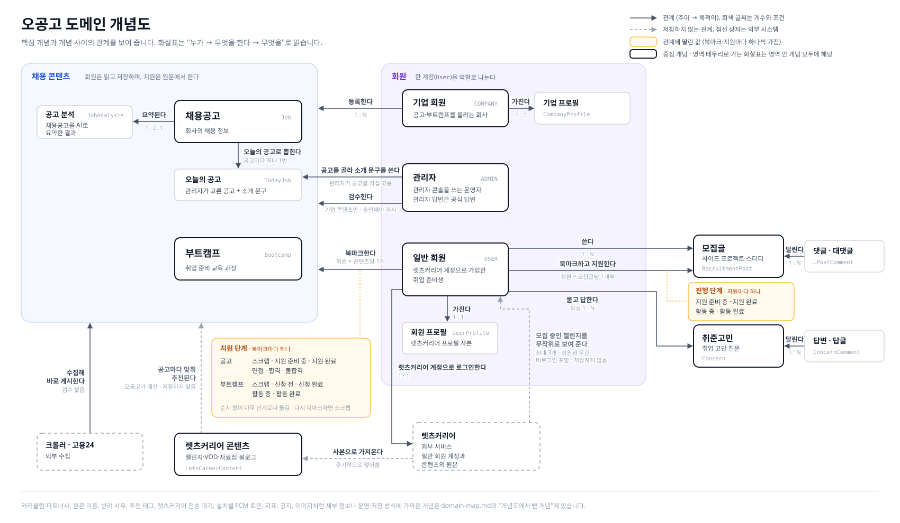

# 오공고 도메인 개념도

- 최종 변경일: 2026-10-27
- 예상 독자: 오공고를 처음 맡는 개발자
- 리뷰 상태: 팀 리뷰 필요

오공고에 어떤 개념이 있고, 누가 무엇에 무엇을 하는지 한 장으로 보여 주는 문서입니다. 서비스 전체 그림은 [서비스 개요](overview.md)에, 용어별 설명은 [용어 사전](glossary.md)에 있습니다.

## 읽는 법

- 화살표는 **주어 → 동사 → 목적어**로 읽습니다. 예를 들어 "기업 회원 → 등록한다 → 채용 콘텐츠"는 기업 회원이 채용공고와 부트캠프를 등록한다는 뜻입니다.
- 화살표가 영역 테두리에 닿으면 그 영역 안의 개념 모두에 해당합니다. 채용 콘텐츠 영역으로 가는 화살표는 채용공고와 부트캠프 둘 다에 적용됩니다.
- 라벨 아래 회색 글씨는 개수(1 : N)와 조건입니다.
- 점선 화살표는 저장하지 않는 관계입니다. 점선 상자는 오공고 밖의 시스템입니다.
- 주황 상자는 **관계에 딸린 값**입니다. 예를 들어 지원 단계는 회원도 공고도 아닌 "회원이 공고를 북마크한 것"에 붙는 값이라, 북마크 관계에 점선으로 매달아 그렸습니다.
- 회원은 한 테이블(`User`)이지만 역할에 따라 하는 일이 전혀 달라서 일반 회원, 기업 회원, 관리자로 나눠 그렸습니다.

이 그림은 **도메인 개념**만 담습니다. 북마크·지원 기록·좋아요처럼 두 개념을 잇는 저장 모델(`JobBookmark`, `RecruitmentPostApplication` 등)은 상자가 아니라 관계로 그렸습니다. 원문 이동, 반려 사유처럼 공통 기능이나 운영·저장 방식에 가까운 개념은 그림에서 빼고 [3. 개념도에서 뺀 개념](#3-개념도에서-뺀-개념)에 모았습니다. 테이블과 컬럼 단위의 구조는 `ogonggo-core`의 각 `domain` 패키지가 기준입니다.

원본은 같은 폴더의 [`domain-map.svg`](domain-map.svg)이고, 도메인이 바뀌면 이 SVG를 직접 고칩니다.

## 1. 영역별 설명

### 채용 콘텐츠: `job`, `bootcamp`

오공고가 회원에게 보여 주는 정보입니다. 회원은 읽고 저장할 뿐 수정하지 않으며, 실제 지원은 원문 링크로 나가서 합니다.

- **채용공고**(`Job`)와 **부트캠프**(`Bootcamp`)가 중심입니다. 둘 다 모집 상태, 게시 상태, 검수 상태를 따로 가집니다. 상태가 어떻게 바뀌는지는 [라이프사이클](lifecycles.md)에 있습니다.
- 콘텐츠는 세 경로로 들어옵니다. 크롤러와 고용24가 수집한 콘텐츠는 검수 없이 바로 게시되고, 기업 회원이 등록한 콘텐츠는 관리자가 승인해야 게시됩니다. **등록 경로에 따라 규칙이 다르므로 공고·부트캠프 기능을 고칠 때는 등록 경로부터 확인합니다.**
- 채용공고를 AI로 요약한 결과가 **공고 분석**(`JobAnalysis`)입니다. AI 서버가 만들어 보내며, 공고 본문이 바뀌면 보여 주지 않고 다시 요약합니다.
- **오늘의 공고**(`TodayJob`)는 관리자가 채용공고 중 몇 개를 골라 소개 문구(제목·설명)를 붙인 것입니다. 목록을 통째로 바꾸며, 회원에게는 그중 게시 중인 공고만 보입니다.

### 회원: `user`

- **일반 회원**은 렛츠커리어 계정으로 로그인하는 취업 준비생입니다. 공고와 부트캠프를 **북마크**하고, 북마크마다 **지원 단계**를 직접 옮기며 지원 과정을 관리합니다. 단계는 공고가 6개(스크랩·지원 준비 중·지원 완료·면접·합격·불합격), 부트캠프가 5개(스크랩·신청 전·신청 완료·활동 중·활동 완료)이고, 순서 없이 아무 단계로나 옮길 수 있습니다. 북마크를 지웠다가 다시 하면 스크랩부터 시작합니다. 렛츠커리어 계정과 1:1로 대응하고, **회원 프로필**에 렛츠커리어 프로필의 사본과 오공고에서 입력한 학년·희망 조건을 둡니다.
- **기업 회원**은 공고와 부트캠프를 직접 올리는 회사입니다. 오공고가 이메일·비밀번호를 직접 갖고, **기업 프로필**에 기관명·로고·담당자 정보를 둡니다.
- **관리자**는 관리자 콘솔을 쓰는 운영자입니다. 기업 콘텐츠를 검수하고, 오늘의 공고를 고르고, 취준고민에 공식 답변을 답니다.

### 모집글: `recruitmentpost`

**모집글**(`RecruitmentPost`)은 사이드 프로젝트·스터디 팀원을 모으는 글입니다. 회원은 모집글을 쓰고, 다른 회원의 모집글을 북마크하거나 연락처를 열어 지원합니다. 여기서 지원은 지원서 제출이 아니라 연락처를 열어 본 것이며, 지원마다 **진행 단계**(지원 준비 중·지원 완료·활동 중·활동 완료)를 회원이 직접 옮깁니다.

### 취준고민: `concern`

**취준고민**(`Concern`)은 취업 준비 고민을 묻고 답하는 게시판입니다. 고민글에 달린 댓글이 답변, 답변에 단 댓글이 답글입니다.

### 사용자 알림함: `usernotification`, `notification`

- **사용자 알림함**(`UserNotification`)은 모집글 부모 댓글의 새 답글·취준고민 글의 새 최상위 댓글 또는 관리자가 발송한 메시지입니다. 관리자 메시지는 발송 묶음별·활성 회원별 한 건이며 게시글·댓글 ID 없이 이동 URL을 가집니다. 수신 회원에게 표시 스냅샷과 읽음 시각을 보관하고 최근 30일을 조회합니다.
- **발송 기록**(`Notification`)은 수신자의 활성 설치마다 생성합니다. 알림함 한 건에 발송 기록 0~N건이 연결되며 토큰이 없으면 알림함만 남깁니다. FCM 접수·실패는 읽음 상태를 바꾸지 않습니다.

### 렛츠커리어 추천: `letscareercontent`, `challenge`

렛츠커리어의 교육 프로그램과 자료를 오공고 화면에서 추천합니다. 비슷해 보이지만 고르는 주체가 다릅니다.

- **공고별 콘텐츠 추천**: 공고 상세에서 그 공고 준비에 맞는 **렛츠커리어 콘텐츠** 3개를 오공고가 고릅니다. 콘텐츠 사본은 렛츠커리어 목록으로 주기적으로 덮어쓰고, 공고를 열 때마다 공고의 직군·직무·공고 분석과 콘텐츠의 추천 태그를 비교해 계산합니다. 결과는 저장하지 않습니다. 콘텐츠가 언제 추천 대상이 되고 빠지는지는 [라이프사이클](lifecycles.md)에 있습니다.
- **추천 챌린지**: 렛츠커리어에서 모집 중인 챌린지 최대 3개를 화면을 열 때마다 받아 와 그대로 보여 줍니다. 지금은 렛츠커리어 서버가 회원과 상관없이 무작위로 고르고, 비로그인 방문자에게도 똑같이 보여 줍니다. 오공고는 고르지도 저장하지도 않으며, 렛츠커리어가 응답하지 않으면 빈 목록을 보여 줍니다.

### 광고 문의: `advertisementinquiry`

**광고 문의**(`AdvertisementInquiry`)는 기업 담당자가 오공고에 홍보를 맡기려고 남기는 영업 문의입니다. 무료 홍보 신청만이 아니라 광고 문의 전체를 한 곳에 두고 **문의 유형**과 **캠페인 코드**로 나눕니다.

- 오공고 회원이 아니어도 남깁니다. 로그인한 상태면 서버가 회원과 **회원 구분**(기업 회원·일반 회원)을 함께 저장하고, 아니면 비회원입니다. 문의 시점의 값이라 나중에 역할이 바뀌어도 고치지 않습니다.
- 어디서 들어왔는지(**유입 경로**)는 UTM과 referrer로 저장할 때 한 번 판정하고 원본도 함께 남깁니다.
- 관리자(영업)가 **처리 상태**(접수·연락함·집행 완료·반려)와 메모를 바꿉니다. 문의 내용은 바꾸지 않습니다.
- 가격·결제·집행 기록은 두지 않습니다. 유료 상품이 생기면 상품·주문을 따로 두고 문의는 그 앞단으로 남깁니다.

## 2. 주요 관계

| 누가 | 무엇을 한다 | 무엇을 | 개수와 조건 | 코드에서 |
| --- | --- | --- | --- | --- |
| 기업 회원 | 등록한다 | 채용공고, 부트캠프 | 1 : N | `Job.ownerUserId`, `Bootcamp.ownerUserId` |
| 크롤러·고용24 | 수집해 바로 게시한다 | 채용공고, 부트캠프 | 검수 없음 | `ContentSource` |
| 관리자 | 검수한다 | 채용공고, 부트캠프 | 기업이 등록한 것만. 승인해야 게시 | `reviewStatus` |
| 관리자 | 공고를 골라 소개 문구를 쓴다 | 오늘의 공고 | 관리자가 공고를 직접 고름 | `TodayJob` |
| 채용공고 | 오늘의 공고로 뽑힌다 | 오늘의 공고 | 공고마다 최대 1번. 게시 중인 공고만 회원에게 보임 | `TodayJob.jobId` |
| 채용공고 | AI로 요약된다 | 공고 분석 | 공고 하나에 최대 하나 | `JobAnalysis.jobId` |
| 일반 회원 | 북마크한다 | 채용공고, 부트캠프 | 회원 × 콘텐츠당 1개. 북마크마다 지원 단계를 가짐 | `JobBookmark`, `BootcampBookmark` |
| 일반 회원 | 쓴다 | 모집글, 취준고민 | 1 : N | `authorUserId` |
| 일반 회원 | 북마크한다 | 모집글 | 회원 × 모집글당 1개 | `RecruitmentPostBookmark` |
| 일반 회원 | 지원한다 (연락처를 연다) | 모집글 | 회원 × 모집글당 1개. 지원마다 진행 단계를 가짐 | `RecruitmentPostApplication` |
| 댓글, 답변 | 달린다 | 모집글, 취준고민 | 1 : N. 댓글에 다시 댓글이 달림 | `parentId` |
| 일반 회원 | 렛츠커리어 계정으로 로그인한다 | 렛츠커리어 | 1 : 1 | `User.letsCareerUserId` |
| 일반 회원 / 기업 회원 | 가진다 | 회원 프로필 / 기업 프로필 | 1 : 1 | `UserProfile.userId`, `CompanyProfile.userId` |
| 회원 | 보관한다 | 사용자 알림함 | 수신자 1 : N. 댓글은 발생 글·댓글을, 관리자 메시지는 발송 묶음을 식별 | `recipientUserId`, `actorUserId`, `type`, `postId`, `commentId`, `batchId` |
| 사용자 알림함 | 발송한다 | 발송 기록 | 1 : 0..N. 활성 설치마다 적재하며 기존 일반 발송의 연결은 선택 | `Notification.userNotificationId` |
| 렛츠커리어 콘텐츠 | 공고마다 맞춰 추천된다 | 채용공고 | 저장하지 않음. 공고를 열 때 계산 | `LetsCareerContentRecommendPolicy` |
| 렛츠커리어 | 모집 중인 챌린지를 보여 준다 | 일반 회원 (비로그인 포함) | 최대 3개를 무작위로. 회원과 무관하고 저장하지 않음 | `LetsCareerChallengeClient` |
| 렛츠커리어 | 사본을 보낸다 | 렛츠커리어 콘텐츠 | 주기적으로 덮어씀 | `LetsCareerContent.externalId` |
| 회원·비회원 기업 담당자 | 남긴다 | 광고 문의 | 1 : N. 비회원이면 회원 없음. 회원 구분은 서버가 토큰으로 정함 | `AdvertisementInquiry.userId`, `memberType` |
| 관리자 | 처리 상태와 메모를 바꾼다 | 광고 문의 | 상태 사이 전이를 막지 않음 | `AdvertisementInquiry.status`, `memo` |

엔티티끼리는 JPA 연관관계를 맺지 않고 상대의 식별자만 컬럼으로 가집니다. 이유와 예외는 [레이어와 모듈 아키텍처의 JPA 연관관계 규칙](../../../docs/architecture/layers-and-modules.md#8-엔티티-삭제와-jpa-연관관계-규칙)을 봅니다.

## 3. 개념도에서 뺀 개념

오공고를 처음 이해하는 데는 없어도 되지만, 해당 기능을 고칠 때는 알아야 하는 개념입니다. 기준은 "이걸 모르고 핵심 기능을 고치면 사고가 나는가"입니다. 그렇다면 개념도에 넣고, 아니면 여기에 둡니다.

### 공통 기능

| 개념 | 코드 | 하는 일 | 이럴 때 알아야 한다 |
| --- | --- | --- | --- |
| 원문 이동 | `SourceUrlClick` | 회원이 공고 원문이나 부트캠프 지원 페이지로 나간 기록. 취소할 수 없고 회원·콘텐츠마다 한 행 | 지원 전환이나 이동 집계를 다룰 때 |
| 반려 사유 | `ContentRejection` | 관리자가 기업 콘텐츠를 반려하며 남긴 말. 콘텐츠마다 한 행이고, 반려가 풀리면 지운 것으로 표시. 콘텐츠가 지워져도 기록은 남김 | 검수 화면이나 기업 회원에게 반려 이유를 보여 줄 때 |
| 댓글 신고 | `RecruitmentPostCommentReport` | 모집글 댓글에 대한 신고 | 신고·제재 기능을 다룰 때 |
| 커리큘럼 · 파트너사 | `BootcampCurriculum`, `BootcampPartner` | 부트캠프의 회차별 교육 내용과 참여 기업. 부트캠프 상세에 보여 주는 세부 정보 | 부트캠프 등록·상세 화면을 다룰 때 |
| 답변 좋아요 | `ConcernCommentLike` | 취준고민 답변의 좋아요. 회원·답변 쌍마다 하나 | 답변 정렬이나 좋아요 수를 다룰 때 |
| 고민글 사진 | `ConcernImage` | 고민글에 첨부한 사진(최대 3장). 이미지 식별자와 URL을 함께 둠 | 고민글 사진을 다룰 때 |
| 모집글 사진 | `RecruitmentPostImage` | 모집글에 첨부한 사진(최대 3장). 이미지 식별자와 URL을 함께 둠 | 모집글 사진을 다룰 때 |
| 태그 | `Tag`, `JobTag` | 공고에 붙는 자유 태그 | 공고 태그 입력·검색을 다룰 때 |
| 공지 | `Announcement` | 관리자가 올리는 공지. 노출과 상단 고정을 따로 관리 | 공지 기능을 다룰 때 |
| 서비스 의견 | `ServiceFeedback` | 좋은 점·아쉬운 점 의견. 비로그인도 남길 수 있음 | 의견 수집 기능을 다룰 때 |

### 운영·저장 방식

| 개념 | 코드 | 하는 일 | 이럴 때 알아야 한다 |
| --- | --- | --- | --- |
| 추천 태그 | `LetsCareerContentTags` | AI 서버가 렛츠커리어 콘텐츠에 붙인 직군·직무·준비 단계. 태그가 없으면 추천하지 않음 | 공고별 콘텐츠 추천 결과를 바꿀 때 |
| 토픽 구독 동기화 | `FcmTopicSyncTask` | 토큰별 최신 구독 희망 상태와 실패 재처리. 공통 공지의 FCM 구독을 실제 기기에 반영 | 전체 토픽 구독·해제와 최초 구독 진행을 다룰 때 |
| 공통 공지 읽음 | `NotificationBroadcastRead` | 회원×공통 배치별 최초 읽음 시각. 미읽음 회원 행은 만들지 않음 | 공통 알림함·미읽음·읽음을 다룰 때 |
| 발송 묶음 | `NotificationBatch` | 어드민이 요청한 FCM 발송의 요청자·대상·본문·적재/제외 건수. 회원별 알림함은 `UserNotification.batchId`, 발송 기록은 `Notification.batchId`로 연결. 토픽 배치는 공통 공지 원문으로 조회하고 `NotificationBroadcastRead`로 회원별 읽음 기록 | 어드민 발송 요청과 운영 이력을 다룰 때 |
| 설치별 FCM 토큰 | `UserFcmToken` | 회원이 여러 설치의 푸시 수신 토큰을 가짐. 활성 설치·토큰은 한 계정에만 연결하고 해제한 행은 소프트 삭제. 설치 UUID가 없는 기존 클라이언트는 회원별 슬롯 사용 | 토큰 등록·해제·소유권 전환이나 푸시 발송을 다룰 때 |
| 렛츠커리어 전송 대기 | `LetsCareerJobProfileOutbox` | 렛츠커리어로 보낼 학력·희망 조건 변경. 회원마다 한 행이고 스케줄 작업이 최신 값을 보냄 | 회원 프로필의 학력·희망 조건을 고칠 때 |
| 닉네임 전송 대기 | `LetsCareerNicknameOutbox` | 렛츠커리어로 보낼 닉네임 변경. 전송 대기와 같은 방식으로 회원마다 한 행이고 스케줄 작업이 최신 닉네임을 보냄 | 회원 닉네임을 고칠 때 |
| 지표 | `JobMetric`, `BootcampMetric`, `ConcernMetric`, `RecruitmentPostMetric` | 조회 수·북마크 수·댓글 수 같은 집계. 인기순 정렬에 씀 | 정렬이나 카운트를 다룰 때 |
| 사진 | `BootcampImage` | 부트캠프 상세에 보여 줄 사진 | 부트캠프 상세 화면을 다룰 때 |
| 이미지 | `ImageAsset` | 업로드한 이미지 파일. 쓰이지 않으면 정리 작업이 지움 | 이미지 업로드나 본문 이미지를 다룰 때 |
| 지역 | `Region`, `SubRegion` | 시·도와 시·군·구. 공고의 근무지 값 | 지역 필터나 고용24 수집을 다룰 때 |
| 스케줄 작업 | `ScheduledJob` | 주기 작업의 실행 주기와 켜짐 여부. 운영자가 DB에서 바꿈 | 주기 작업을 추가하거나 바꿀 때 |

상태가 있는 개념의 전이 규칙은 [라이프사이클](lifecycles.md)에, 각 용어의 자세한 뜻은 [용어 사전](glossary.md)에 있습니다.
