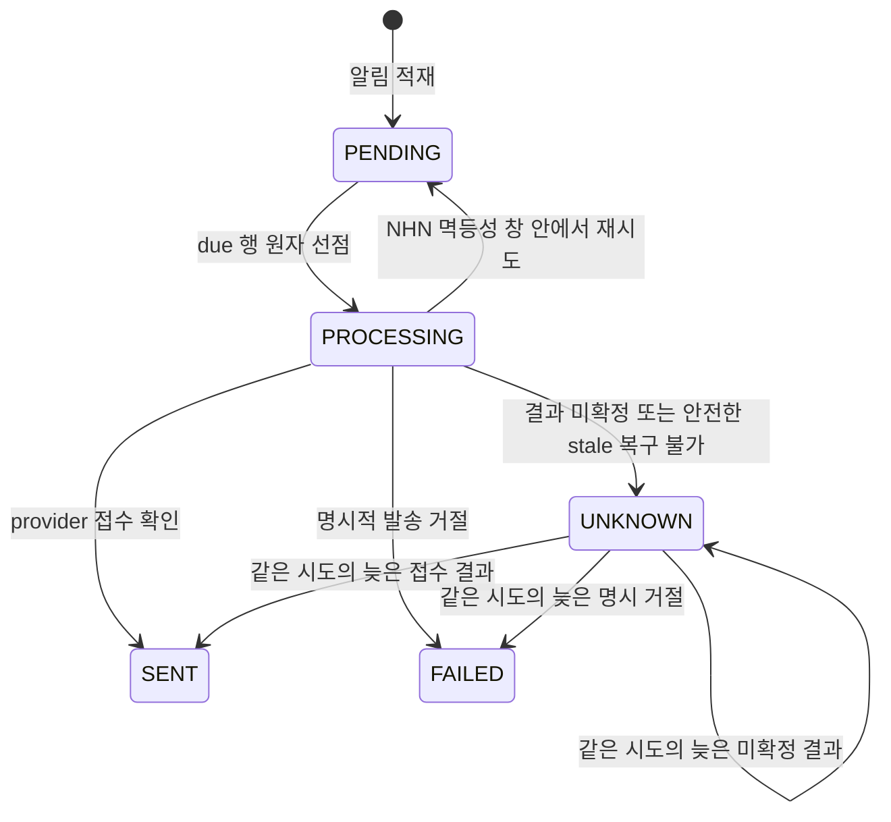
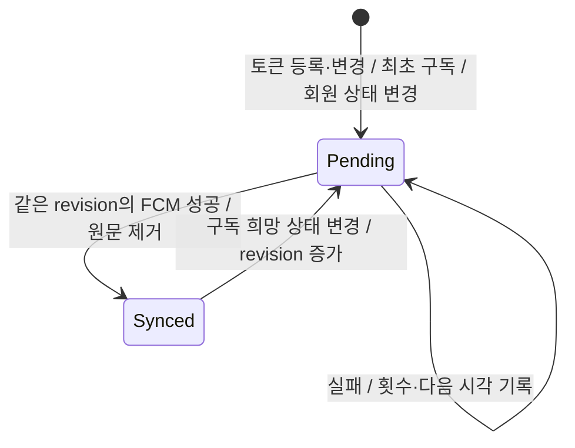

# 오공고 라이프사이클

- 최종 변경일: 2026-10-12
- 예상 독자: 상태가 있는 엔티티를 고치거나 리뷰하는 개발자
- 리뷰 상태: 팀 리뷰 필요

상태가 바뀌는 엔티티와 그 전이 규칙을 모은 문서입니다. 전이 규칙이 있는 엔티티는 다이어그램으로 그렸고, 단순히 켜고 끄는 상태나 규칙 없이 고르는 상태는 아래 표에만 적었습니다. 상태 값의 뜻은 [용어 사전](glossary.md)에 있습니다.

## 1. 다이어그램

| 대상 | 다이어그램 | 한 줄 요약 |
| --- | --- | --- |
| 채용공고·부트캠프 | [content.html](lifecycles/content.html) | 게시·검수·모집 상태가 따로 움직입니다. 기업 등록 콘텐츠만 검수를 거치고, 승인하면 바로 게시됩니다. |
| 모집글 | [recruitment-post.html](lifecycles/recruitment-post.html) | 임시저장 글은 필수 값을 채워야 게시됩니다. 숨김과 다시 공개는 운영자만 하며, 모집 상태는 게시된 글에만 있습니다. |
| 이미지 | [image-asset.html](lifecycles/image-asset.html) | 업로드 → 임시 → 첨부 순으로 바뀝니다. 첨부되지 않은 채 보존 기간이 지나면 정리 작업이 S3에서 지웁니다. |
| 렛츠커리어 전송 대기 | [letscareer-outbox.html](lifecycles/letscareer-outbox.html) | 회원마다 한 행이고, 실패하면 대기로 남아 다음 실행에서 다시 보냅니다. 닉네임 전송 대기(`LetsCareerNicknameOutbox`)도 같은 방식으로 움직입니다. |
| 렛츠커리어 콘텐츠 | [letscareer-content.html](lifecycles/letscareer-content.html) | 목록 상태와 태그 상태가 따로 움직입니다. 목록에 있고 태그가 최신이며 모집 기간인 콘텐츠만 공고별로 추천됩니다. 제목·설명이 바뀌면 다시 태그할 때까지 추천에서 빠집니다. |
| 알림 발송 기록 | [아래 상태도](#알림-발송-기록) | 발송 전에 `PROCESSING`으로 선점하며, stale 복구와 늦은 provider 결과를 attempt 단위로 구분합니다. |

분리된 Archify 다이어그램의 `SRC` 배지를 누르면 근거가 된 코드 줄로 이동합니다. GitHub에서는 HTML이 렌더링되지 않으니 내려받아 브라우저로 엽니다. 알림 상태도의 근거는 [`Notification`](../../src/main/kotlin/com/ogonggo/core/notification/domain/Notification.kt)과 [`NotificationManager`](../../src/main/kotlin/com/ogonggo/core/notification/delivery/implement/NotificationManager.kt)입니다.

### 알림 발송 기록



`PROCESSING`은 provider 요청을 시작하기 전에 기록하고, provider별 stale timeout은 이 시작 시각부터 계산합니다. timeout은 실패 증거가 아닙니다. NHN만 최초 시도 시각 기준 멱등성 창 안에서 제한 재시도하며, 재시도하지 않은 `UNKNOWN`은 같은 시도의 늦은 결과가 오면 정정할 수 있습니다. `UNKNOWN` 결과나 업무 발송 기한 만료는 자동 재발송하지 않습니다.

## 2. 다이어그램이 없는 상태

| 대상 | 상태 | 그리지 않은 이유 |
| --- | --- | --- |
| 회원 `User` | 활성 / 탈퇴 / 정지 | 탈퇴한 회원은 정지·활성화할 수 없다는 규칙은 있지만, 지금은 이 전이를 호출하는 API가 없습니다. 확인 필요: 회원 탈퇴·정지 기능의 도입 계획 |
| 공고·부트캠프 북마크 | 지원 단계 / 신청 단계 | 회원이 아무 단계로나 옮길 수 있어 전이 규칙이 없습니다. 북마크를 다시 하면 스크랩으로 돌아갑니다. |
| 모집글 지원 기록 | 진행 단계 | 북마크와 같이 규칙 없이 옮깁니다. 삭제된 기록만 바꿀 수 없습니다. |
| 공지, 취준고민 | 노출 / 숨김 | 운영자가 켜고 끄는 값 하나뿐입니다. |

### 전체 토픽 구독 동기화



- `FcmTopicSyncTask.pending=true/false`를 Pending/Synced로 표시한다. subscribe/unsubscribe는 `desiredSubscribed`로 구분하고 결과는 같은 revision에만 반영한다.
- 구독 실패 재처리와 `Notification`의 푸시 결과 상태는 독립적이다. 구독 실패는 5초부터 최대 1시간 간격으로 재처리한다.

## 3. 다이어그램 고치기

다이어그램은 [Archify](https://github.com/tt-a1i/archify)로 만듭니다. 원본은 같은 폴더의 `*.archify.json`이고, HTML은 여기서 만든 결과물입니다.

1. 상태 전이 코드를 바꾸면 해당 JSON의 상태·전이와 `sources`의 줄 번호를 고칩니다.
2. `meta.repository.revision`을 근거 코드가 들어 있는 커밋으로 바꿉니다. Archify는 이 커밋에서 줄 번호를 검증합니다.
3. 저장소 루트에서 다음 명령을 실행합니다.

```bash
node <archify 설치 경로>/bin/archify.mjs finalize lifecycle ogonggo-core/docs/domain/lifecycles/<이름>.archify.json ogonggo-core/docs/domain/lifecycles/<이름>.html --repo-root . --quality showcase
```

검증 기록 파일(`*.finalize.json` 등)은 `.gitignore`에 있어 커밋되지 않습니다.
